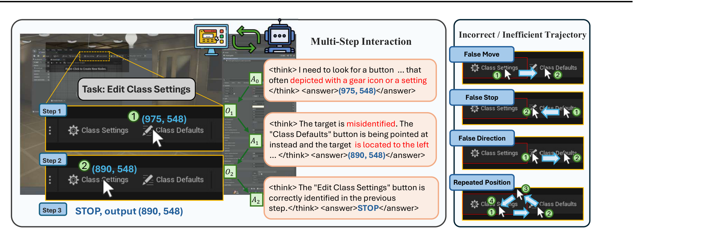
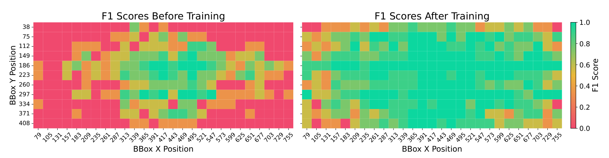
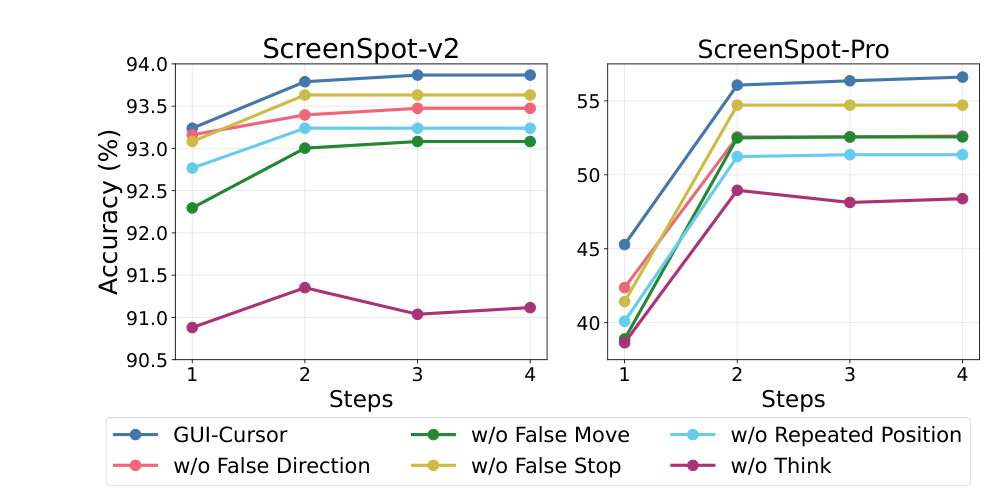

---
tags:
  - papers/gui-agent
  - papers/vision-grounding
aliases:
  - GUI-CURSOR
  - Learning GUI Grounding with Spatial Reasoning from Visual Feedback
date: 2026-11-02
arxiv_id: "2509.21552"
---

# GUI-CURSOR：把 GUI 定位从坐标回归改写成光标搜索

## 核心信息

- 标题：Learning GUI Grounding with Spatial Reasoning from Visual Feedback
- 标题翻译：从视觉反馈中进行空间推理的 GUI 定位学习
- 作者：Yu Zhao、Wei-Ning Chen、Huseyin A. Inan、Samuel Kessler、Lu Wang、Lukas Wutschitz、Fangkai Yang、Chaoyun Zhang、Pasquale Minervini、Saravan Rajmohan、Robert Sim
- 机构：爱丁堡大学、微软、Miniml.AI
- 发表时间：2026 年（arXiv 第二版 2026-05-25）
- 发表渠道：ICML 2026（PMLR 306）
- arXiv：2509.21552
- 论文链接：https://arxiv.org/abs/2509.21552
- 数据 / 资源：训练数据取自 Aria-UI 与 OS-Atlas 的 grounding 子集，按 GTA1 的过滤与预处理脚本采样，约 8K 条；评测使用 ScreenSpot-v2、ScreenSpot-Pro、OSWorld-G、UI-Vision、OSWorld，并自建 cursor-in-box 探针与 SpatialMQA、SPHERE 两个空间推理基准
- 论文类型：AI 方法（强化学习训练的 GUI 视觉定位模型）

## 原文摘要翻译

GUI 定位通常被表述为一个坐标预测任务——给定自然语言指令，生成屏幕坐标以执行点击、按键等动作。然而，近期的视觉语言模型在处理高分辨率、复杂布局的 GUI 图像时，往往无法预测出准确的数值坐标。
为解决这一问题，我们把 GUI 定位重新表述为一个交互式搜索任务：VLM 生成动作，在 GUI 中移动光标以定位 UI 元素。
在每一步，模型判定目标对象、评估光标与目标之间的空间关系，并以移动历史为条件把光标移近目标。在这一交互过程中，渲染出的光标提供了视觉反馈，帮助模型把自己的预测与屏幕上相应的位置对齐。
我们使用带稠密轨迹奖励的多步在线强化学习训练该定位模型 GUI-CURSOR。
实验结果表明，GUI-CURSOR 在 GUI 定位与 agentic 任务上超过强基线，在相同底座模型下取得更优性能，且所需训练数据更少。
进一步分析表明，GUI-CURSOR 学会在更困难的样例上自适应地执行更多步，并在分布外领域获得更好的空间推理能力。

## 创新点

- 任务重构：把 GUI 定位从"一次性坐标回归"改写成"在可渲染环境里移动光标做搜索"，模型预测的坐标会被画回截图并成为下一步观测，从而形成显式的视觉反馈回路。
- 稠密轨迹奖励：在位置奖励之外引入假停止、假移动、反向移动、重复位置四类过程惩罚，用 $w_p$ 加权，专门压制"不看清就 STOP"与"原地打转"这两类退化解。
- 训练与推理解耦：训练只在 1920×1080 上做，推理时用 cursor-centric focusing 先粗定位再裁剪同尺寸窗口做精定位，把有限算力花在真正难的局部。
- 能力探针：设计 cursor-in-box 极简测试，把"判断光标与框的空间关系"从"识别目标元素"中剥离出来，为"一步准确率高不等于空间理解好"提供了可复现的证据。

## 一句话总结

GUI-CURSOR 用"移动光标—看回渲染截图—再判断"的多步交互替掉一次性坐标回归，让 UI-TARS-1.5-7B 底座在 ScreenSpot-Pro 上从 50.1% 提到 58.1%，并把收益主要归因于数值坐标与屏幕位置之间的空间对齐被显式训练出来。

## 研究问题

论文要解决的不是"模型不够大"，而是一个结构性缺陷：主流做法（SFT、规则奖励强化学习、架构改造）训练时都只监督最终坐标，模型从未"看到"自己预测的位置落在图像的哪里，因此坐标词元与屏幕位置之间的映射只能靠隐式学习。

这一缺陷在高分辨率、密集布局的桌面上会被放大：同样的相对误差对应更多像素，图标类目标又没有文字线索可供对齐，于是定位精度直接掉档。

论文进一步追问了一个更尖锐的问题：一步预测的高准确率是否意味着模型真的懂空间关系。作者用零样本实验给出了否定线索——Qwen2.5-VL-7B 一步准确率 88.8%，但当它必须根据光标当前位置输出新坐标时，直接移动只剩 36.3%、相对移动只剩 1.3%。这说明它学到的更像"数据集里该往哪写"，而不是"目标在图像中的哪个方位"。

由此论文的目标可以写成三条：让模型在训练中收到关于"预测落在哪"的视觉反馈；让模型在推理时能依据反馈逐步修正；并证明这种修正能力可以迁移到 GUI 之外的图像上。

## 数据与任务定义

### 任务形式化

给定宽 $W$、高 $H$ 的截图与指令 $I$，要输出的是一个整数坐标；真值是一个矩形框，坐标落在框内即判为正确。这个"落框即对"的判定贯穿全部基准，因此 1 个像素的偏差是否致命取决于目标框大小，也决定了小目标天然更难。
多步交互的定义如下：第 0 步时光标渲染在图像中心；之后每一步，模型以交互历史为条件生成一段回答，回答里先写思考段、再写答案段。
答案要么是新坐标（环境把光标画到该点并生成新截图），要么是 STOP（回合结束）。回合在输出 STOP 或达到最大步数时终止，最终光标位置即定位结果。

### 训练数据与筛选

训练数据来自 Aria-UI 与 OS-Atlas 两个 GUI 定位语料，沿用 GTA1 的清洗与预处理流程后随机采样，规模约 8K 条。
这一规模明显小于 GTA1 的 64K、GUI-G2 的 100K 与 GUI-Actor 的 1.76M。

关键的数据侧设计是在线过滤：每条指令采样的轨迹如果全部成功或全部失败，就整条丢弃。这一操作等价于把训练分布持续收敛到"当前策略有时能、有时不能"的中等难度区间，也是后文训练三阶段现象的成因之一。

### 评测协议与基线

四个定位基准覆盖不同难度层次：ScreenSpot-v2 是移动、桌面、网页混合的常规分辨率集合；ScreenSpot-Pro 是高分辨率专业软件（CAD、开发、创意、科学、办公、系统），含大量图标类目标；OSWorld-G 侧重元素匹配与布局理解；UI-Vision 侧重桌面精细操作与空间关系。

在线 agentic 评测用 OSWorld：由 o3 担任规划器，把动作交给待测定位模型取坐标，报告 15、50、100 步预算下的任务成功率。为公平比较，所有定位器共用同一套 o3 规划策略。

### 训练配置

两个底座并行训练：Qwen2.5-VL-7B 与 UI-TARS-1.5-7B，超参完全一致；学习率 1e-6，批大小 32，每条指令采样 12 条轨迹。
训练时最大移动步数 4，最大响应长度 512 个词元，采样温度 0.5，推理用贪心解码。
硬件为 8 张 A100 80G，基于 EasyR1 实现，每 20 步在验证集评估、每 50 步存一次检查点，主实验取第 200 步的模型。光标贴图为 20×31 像素、热点在左上角，初始位置固定在图像中心。

## 方法主线

GUI-CURSOR 的机制可以概括为"渲染即监督"：模型的输出不再是终点，而是下一次观测的起点。下面按执行链、奖励、更新、推理四个层面拆开。

### 机制流程

1. 输入与初始化：输入原始截图 $O$ 与自然语言指令 $I$，环境把 $20\times 31$ 的光标渲染到图像中心，得到首帧观测 $O_0$，送入策略模型。
2. 单步空间推理与作答：策略以交互历史为条件，先在思考段里识别目标元素、描述光标与目标的相对方位，再在答案段输出新坐标 $(x_{t+1},y_{t+1})$ 或 STOP。
3. 环境回写与观测更新：若输出坐标，渲染器把光标移到该点、生成新截图 $O_{t+1}$ 并追加到历史；若输出 STOP，环境终止回合，最终光标位置作为定位预测输出给下游。
4. 轨迹奖励与策略更新：回合结束后按最终位置算位置奖励、按整条轨迹算四类惩罚，合成轨迹奖励送入 GRPO 更新策略，更新后的策略进入下一轮采样。

*图 1：GUI-CURSOR 的交互流程（左）与被惩罚的四类错误轨迹（右）。左图展示"Edit Class Settings"任务上三步收敛到 (890, 548) 的过程；右图依次给出假移动、假停止、反向移动、重复位置四种退化行为。*

### 位置奖励与轨迹惩罚

位置奖励只评价终点质量，沿用 SE-GUI 的稠密距离形式：落框内时同时考虑"是否靠中心"，落框外时按到最近边的距离给分。

$$r_p = 2 - \frac{d_{centre}}{d_{max}}, \qquad (x_T,y_T) \in B$$

$$r_p = 1 - d_{edge}, \qquad (x_T,y_T) \notin B$$

其中 $d_{edge}$ 是终点到框最近边的欧氏距离，$d_{centre}$ 是到框中心的距离，$d_{max}$ 是框顶点到中心的距离，所有距离按图像宽高归一化。工程含义很直接：框内奖励上限 2、越靠中心越高；框外奖励随距离衰减到 0，因此"差一点"和"差很远"被区分开，而不是一律 0。

只有位置奖励会诱发两类坏策略：完全不看反馈直接 STOP，以及反复输出同一个坐标等待环境变化。为此论文加了四项指示函数惩罚，每项对应一种可判定的坏轨迹。

- 假停止 $r_{FS}$：输出了 STOP 但终点不在框内，惩罚"没看清就收工"。
- 假移动 $r_{FM}$：历史上曾经进过框，却继续移动并把最终位置挪到框外，惩罚"走对了还乱动"。
- 反向移动 $r_{FD}$：终点比首步预测离框更远，惩罚"越改越偏"。
- 重复位置 $r_{RP}$：轨迹中出现两次相同坐标，惩罚"原地打转"。

四项惩罚合并为轨迹奖励，$w_p$ 控制惩罚总强度（实验中取 0.2）：

$$R_T = r_p - w_p\,(r_{FS} + r_{FM} + r_{FD} + r_{RP})$$

这组设计的关键不在公式，而在它把"搜索过程是否合理"变成了可优化的信号。消融显示假停止惩罚尤其关键：去掉它之后，模型在 20 步训练内就收敛到"永远一步"，因为一步预测的期望奖励已经够高，多走一步反而多担风险。

### GRPO 训练目标

每条轨迹的整体奖励是轨迹奖励与格式奖励的加权和，格式项只检查"先思考后作答"的结构是否成立：

$$R = 0.9\,R_T + 0.1\,R_{format}$$

同一指令的 $N$ 条轨迹构造成组，用组内标准化得到优势，从而免去价值网络：

$$\hat{A}_i = \frac{R_i - \mathrm{mean}(R_{1..N})}{\mathrm{std}(R_{1..N})}$$

策略用带截断的重要性比做保守更新，并沿用前作结论省略 KL 正则项：

$$J(\theta) = \mathbb{E}\Big[\min\big(\rho_i(\theta)\hat{A}_i,\ \mathrm{clip}(\rho_i(\theta),1-\epsilon,1+\epsilon)\hat{A}_i\big)\Big]$$

轨迹采样的细节值得注意：首步对同一初始历史采样 $N$ 个互不约束的响应，后续步每条轨迹只采样 1 个响应，直到该轨迹输出 STOP 或触顶。换言之，探索集中在"第一步往哪走"，之后是各自的贪心延续，这也是为什么首步质量对最终精度影响很大。

### Cursor-Centric Focusing

多步交互的代价是历史越长、图像越大，编码成本越高。论文用两段式策略把训练成本与推理精度分开处理。

训练阶段把图像等比缩到 1920×1080 以内，让模型在小图上学会"边看边走"的策略；代价是小图标在训练时几乎不可辨，模型只能学到"大致方位"。推理阶段对超过训练分辨率的图像启用 CCF：先用一步在整图上拿到粗预测，再以该点为中心裁一块 1920×1080 的窗口（贴边时平移保证窗口完整），后续步只在这个窗口内细调，且不再把原始大图放进历史。

于是同一套权重可以处理 4K 截图：粗定位负责"找到大概位置"，精定位负责"落在像素级目标上"。

> [!figure] Figure 3 CCF 消融对比
> 建议位置：方法主线 · Cursor-Centric Focusing
> 放置原因：该柱状图直接对比有无 CCF、以及把同一裁剪策略套到 GTA1 与 GUI-G2 后的结果，是"收益不全来自裁剪"这一判断的关键证据。
> 当前状态：保留占位，原始图的裁剪候选缺失，对应数值已在下文消融表中逐项列出。

## 关键结果

### ScreenSpot-Pro：难基准上的主要收益

ScreenSpot-Pro 是最能区分方法的集合：高分辨率、专业软件、图标类目标占比高。GUI-CURSOR 在两个底座上都刷新了同底座最好成绩，UI-TARS-1.5-7B 版本达到 58.1%。

| 方法（7B 级） | ScreenSpot-Pro 平均 | 训练样本 |
|---|---|---|
| SeeClick | 1.1 | — |
| OS-Atlas-7B | 18.9 | — |
| UI-TARS-7B | 35.7 | — |
| UI-TARS-1.5-7B | 38.7 | — |
| Jedi-7B | 39.5 | — |
| SE-GUI-7B | 47.3 | — |
| GUI-G2-7B | 47.5 | 100K |
| GUI-Actor-7B | 47.7 | 1.76M |
| GTA1-7B | 50.1 | 64K |
| GUI-CURSOR-7B（Qwen2.5-VL-7B） | 56.5 | ≈8K |
| GUI-CURSOR-7B（UI-TARS-1.5-7B） | 58.1 | ≈8K |

*表 1：ScreenSpot-Pro 平均准确率（%）与训练样本量对照。样本量取自论文正文与训练成本表。*

与同底座的 GTA1 相比提升 8.0 个百分点，而训练样本只有其八分之一。更值得注意的是结构差异：GTA1 的图标类平均 25.2%，GUI-CURSOR 的 UI-TARS 版本达到 50.8%，CAD 类图标从 20.7% 升到 53.1%。图标没有文字可读，只能靠"看图找位置"，这正是视觉反馈回路应当改善的部分；文本类目标提升相对温和，因为文字本身提供了强定位线索。

### ScreenSpot-v2 与在线 agentic 评测

在常规分辨率集合 ScreenSpot-v2 上，两个底座都到 93.9%，高于 GTA1 的 92.4%、GUI-G2 的 93.3% 与 GUI-Actor 的 92.5%。这个集合的头部已经很拥挤，1 到 2 个点的差距更像是"没有退步"，真正的信号在难集合上。
在桌面精细操作集合 UI-Vision 上，平均 27.3% 对 GTA1 的 26.2%，差距主要来自 Spatial 子项（14.2% 对 11.4%），也就是"判断元素之间相对位置"的那一类题。

OSWorld 在线任务更能说明可用性：配合同一 o3 规划器，GUI-CURSOR（Qwen 底座）在 50 步预算下达到 57.1%，超过 GTA1-7B 在 100 步下的 53.1%，也超过 32B 的 GTA1 在 100 步下的 55.4%。换句话说，它用一半的动作预算拿到了更高的任务成功率——定位更准时，规划器浪费的步数更少。

需要提醒的是，这里测的是"规划器 + 定位器"的组合，57.1% 不能全部记在定位器头上；但同一规划器、同一预算下与 GTA1 的对比仍然成立。

### 空间推理：探针与分布外迁移

论文自建的 cursor-in-box 测试把问题压到极简：白底、一个红框、一个黑色光标，问"光标是否在框内"。这个任务不需要识别任何 UI 元素，只考空间关系判断，因此可以把"认错目标"这个混淆因素排除。

*图 6：cursor-in-box 探针的 F1 热图（左：训练前；右：训练后）。横纵轴是框在图像中的位置，颜色越绿 F1 越高。*

训练前的 Qwen2.5-VL-7B 呈明显中心偏置：框在图像中心附近时 F1 高，越靠边缘越差，说明它的"框内/框外"判断很大程度上依赖"目标是否在视野中央"这一先验，而不是局部几何关系。训练后的 GUI-CURSOR 在整幅图上都更绿，且从未在该分类任务上被显式训练。

分布外也有证据：SpatialMQA 上提升 5.3%，而同底座、同样用一步强化学习训练的 GUI-G2 没有这一提升；SPHERE 上的增益集中在 reasoning（+1.9%）与 combine 2 skills（+3.9%）两个子项，恰好是需要组合多个空间判断的类别。

### 消融：惩罚项、思考与 CCF

| 设置 | ScreenSpot-Pro | ScreenSpot-v2 | 多步比例（ScreenSpot-Pro） |
|---|---|---|---|
| GUI-CURSOR 完整 | 56.5 | 93.9 | 9.4% |
| 去掉 CCF | 45.3 | 93.6 | — |
| 去掉假停止惩罚 | — | — | 0.1% |
| 去掉重复位置惩罚 | — | — | 16.6% |
| 去掉 think | 约 49 | 约 91 | 1.1% |
| GTA1-7B 加 CCF | 54.0 | — | — |
| GUI-G2-7B 加 CCF | 52.1 | — | — |

*表 2：消融与迁移结果。带"约"的数值由论文折线图读出，其余为正文或表格值。*

*图 2：奖励惩罚项与思考段的消融曲线。横轴是允许的移动步数，纵轴是准确率；去掉任一惩罚项或去掉思考段，曲线在 2 步以后都低于完整模型。*

三件事值得分开看。第一，CCF 是这套方法里最"便宜"的收益：不加训练、不改模型，ScreenSpot-Pro 上就有 11.2 个点。
把同一策略套到 GTA1 与 GUI-G2 也分别得到 3.9 与 4.6 个点，说明裁剪本身有普适价值；但两者加裁剪后仍低于 GUI-CURSOR，说明"会移动光标"的策略本身也有独立贡献。
第二，去掉 CCF 后 GUI-CURSOR 反而低于 GTA1（45.3 对 50.1），原因是训练分辨率只有 1920×1080，低于 GTA1 的 4096×2160，这提醒我们不要把 CCF 当成可选装饰。
第三，思考段在这套设定里不是可选项：去掉后两条曲线都明显下降，而作者指出这与 GUI-G2、GTA1 的观察相反，原因很可能是多步交互需要显式的空间判断作为中间变量。

### 从 2B 到 32B：底座越强收益是否还在

| 模型 | ScreenSpot-v2 | ScreenSpot-Pro | OSWorld-G |
|---|---|---|---|
| Qwen3-VL-2B-Thinking | 88.9 | 32.2 | 41.8 |
| GUI-CURSOR-2B（同底座） | 92.6 | 55.0 | 58.5 |
| Qwen3-VL-8B-Thinking | 93.6 | 46.6 | 56.7 |
| Qwen3-VL-32B-Thinking | 95.7 | 57.1 | 64.0 |
| GUI-CURSOR-7B（Qwen2.5-VL-7B） | 93.9 | 58.1 | 65.6 |

*表 3：换到更新的 Qwen3-VL 底座后的对照。*

2B 版本把同底座从 32.2% 拉到 55.0%，超过 8B 的原生模型，也逼近 32B（57.1%）。这说明"交互式光标搜索"不是靠模型容量堆出来的技巧，而是可以叠加到更强底座上的训练范式；同时也说明方法本身对底座规模不敏感，2B 与 7B 版本在 ScreenSpot-Pro 上的差距只有 3.1 个点。

## 深度分析

### 为什么"移动光标"能改善坐标对齐

一次性坐标回归的监督信号只有"最终数字对不对"。模型可以靠数据集的统计规律蒙对很多样本，但一旦图像分辨率或布局分布变化，这些规律就失效。把预测画回图像改变了监督的形态：模型在第 $t+1$ 步看到的图像里包含了"我上一步说在哪"，于是"我说的坐标"与"它实际落在哪"在同一个观测里对齐了。

这与视觉思维链的区别在于反馈是环境给的、不是模型想象出来的。模型不需要学会画图，只需要学会读"自己画的那一笔"，因此学习负担比生成式视觉推理小得多，这也是 2B 底座就能受益的原因。

### 训练三阶段与多步策略的涌现

训练曲线呈现出清晰的三段结构，理解它比记住最终分数更有用。

第一阶段（0 到 25 步）是冷启动：模型先学会输出合法格式、把坐标写进答案段，响应长度下降而轨迹奖励上升。第二阶段（50 到 150 步）是单步定位：在线过滤不断剔除已解决的简单样本，轨迹奖励反而下降，平均步数贴近 1，说明模型在变难的分布上继续提升一步精度，但还没学会"走"。第三阶段（150 到 200 步）才是多步搜索：平均步数升到约 1.25，响应变长（思考更多），轨迹奖励回升，ScreenSpot-Pro 的准确率继续爬升。

一个容易忽略的细节是：ScreenSpot-v2 在第 150 步就达到最好的 94.2%，而 ScreenSpot-Pro 一直受益到第 200 步。这解释了为什么"多步"只在难集合上体现价值——简单样本一步就够，多走一步只是增加延迟。

### 自适应步数是"按难度分配计算"的证据

推理时 95% 的样本在两步内收敛：ScreenSpot-v2 只有 0.5% 的样本走多步，ScreenSpot-Pro 是 9.4%。多步样本的目标平均只有 5024 像素，单步样本是 31584 像素，相差 6 倍以上。

这组数字说明模型学到的是"看不准就再看一眼"，而不是"固定走 N 步"。从工程角度看这很划算：平均吞吐只下降约 12.5%，就把计算集中到了真正难的样本上。延迟表也印证了这一点：

| 设置 | ScreenSpot-v2 准确率 | ScreenSpot-v2 延迟（秒） | ScreenSpot-Pro 准确率 | ScreenSpot-Pro 延迟（秒） |
|---|---|---|---|---|
| GTA1-7B，1 步 | 92.4 | 0.26 | 50.1 | 0.58 |
| GUI-CURSOR，1 步 | 93.2 | 0.27 | 45.3 | 0.59 |
| GUI-CURSOR，2 步 | 93.8 | 0.37 | 56.0 | 0.71 |
| GUI-CURSOR，最多 4 步 | 93.9 | 0.37 | 56.5 | 0.89 |

*表 4：端到端单样本延迟与准确率。延迟含光标渲染与历史编码开销。*

把步数预算从 1 步放开到 4 步，ScreenSpot-Pro 上多花 0.30 秒换来 11.2 个点，ScreenSpot-v2 上只多花 0.10 秒、换来 0.7 个点。也就是说，是否启用多步应当由"图像分辨率 + 目标尺寸"的先验来决定，而不是全局固定；作者也把"按难度自适应设置最大步数"列为未来工作。

### 与相邻路线的定位

把这篇放到近两年的 GUI 定位版图里，可以按"计算花在哪"分成四类，GUI-CURSOR 的位置就清楚了。

- 一步 SFT 路线（UGround、OS-Atlas、UI-TARS）：把大规模标注灌进模型，追求单次前向的精度上限，代价是数据量。
- 一步 RL 路线（GUI-G2、SE-GUI、GTA1）：用规则奖励替代标注，但仍只奖励终点；GUI-CURSOR 把奖励扩展到整条轨迹。
- 迭代裁剪路线（GUI-Spotlight、GUI-ARP、GUI-RC）：靠反复裁剪缩小搜索区域，有的需要多阶段训练，有的靠多次采样投票。
- 架构改造路线（GUI-Actor）：让模型输出候选点再交给外部验证器，引入新参数与新训练阶段。

GUI-CURSOR 的差异点在于"用同一套权重、同一个模型做多轮自检"，不引入外部模块；而它的 CCF 又恰好可以反向叠加到别的路线上，这一点让它的贡献具有可组合性。

### 成本结构与复现门槛

训练侧的成本是真实的：单步采样每步约 289 秒，四步采样升到约 680 秒，瓶颈在轨迹生成（157 秒升到 432 秒）。推理侧 2 步与 3 步分别损失 11% 与 41% 吞吐。

复现门槛主要在三处：需要自建带光标渲染的交互环境；需要 EasyR1 这类支持多轮采样的强化学习框架与 vLLM 推理；需要 8 张 A100 80G 跑 200 步以上。相对而言数据门槛低（约 8K 条），这对资源有限的研究组是友好的一面。

## 局限

### 首步错误无法恢复

CCF 的窗口以首步预测为中心，一旦首步偏得离谱，目标就不在窗口内，后续步再多也无法补救。论文自己测了这个比例：ScreenSpot-Pro 约 10.3% 的样本属于此类。作者尝试让模型判断"目标是否在视野内"，结果只有 31% 的召回，且有 20% 的假阳——而基础发生率只有 10.3%，20% 的假阳会把大量本来正确的裁剪丢掉，因此不能直接接一个"重新放大"的动作。要真正闭环，需要把"目标存在性"作为一类信号写进奖励，这被留作未来工作。

### 分辨率与任务形态的边界

训练分辨率 1920×1080 是算力与精度的折中，论文明确说这会让小图标在训练时"只能学到大致的方位"，靠 CCF 在推理时补。这意味着方法的上限仍受首步粗定位精度限制；若不提高训练分辨率或引入学习式的区域选择，4K 以上的极端场景会继续受限。

任务形态上，全文只验证了点击式单点定位。拖拽、滑动需要两个坐标并存在跨坐标依赖，论文只做了可行性讨论并引用 GUI-Drag 的结果（Qwen2.5-VL-7B 在拖拽任务上成功率仅 2.6%），没有做实验。因此"多步光标搜索能处理连续交互"目前只是推测。

### 并非全面领先的任务类型

OSWorld-G 上并非全面领先：Match 66.7 对 GTA1 的 82.1。
Element Recognition 70.4 对 74.2，Fine-grained Manipulation 65.6 对 67.7。
增益集中在文本类（Text，77.0 对 63.2）与布局理解（Layout Understanding，67.4 对 42.9），说明这套方法更擅长"理解布局与读字"，对严格的元素匹配并不占优。这也提示"多步搜索"改变的是搜索过程，并不能弥补目标识别本身的差距。

### 证据强度与未验证项

第一，因果归因偏弱。cursor-in-box 的提升被解释为"轨迹惩罚鼓励了正确的空间思考过程"，但论文没有做"只用位置奖励、不加惩罚"的对照训练，因此无法分离多步交互与奖励塑形各自的贡献。

第二，消融报告的粒度不一致。惩罚项消融主要用多步比例与训练曲线说话，逐项准确率的差值只在折线图上可见，没有给出数值表。

第三，超参是经验性的：$w_p=0.2$ 为默认值，把假停止惩罚提到 0.5 只是"略有提升"，没有系统搜索。

第四，样本量口径存疑。正文多处说约 8K，但论文的训练成本表里 GUI-CURSOR 两行未列出样本量，复现时需要自行确认。

## 我的笔记

### 可迁移的三个工程点

把"输出画回输入"当成一种通用监督。任何坐标型任务（图表读数、CAD 标注、文档版面定位）都可以用同样的渲染回写构造反馈，成本只是一次图像合成。这个技巧与具体模型无关，值得作为基线工具箱的常备项。

过程惩罚的四个模式可以直接复用：假停止对应"没有证据就下结论"，假移动对应"证据出现过又丢掉"，反向移动对应"修正方向错了"，重复状态对应"卡死在环里"。这四类几乎覆盖了多步 agent 的典型退化行为，而且都可以用纯规则判定，不需要奖励模型。

CCF 是零训练成本的推理期插件。实现要点只有三个：窗口尺寸等于训练分辨率、窗口尽量居中、贴边时平移而不是缩小。把它套到现成模型上，先量一下首步命中率，再决定是否值得开启。

### 复现清单

环境侧：光标贴图 20×31、热点左上、初始位置图像中心、越界时贴边裁剪。模型侧：系统提示要求先 think 后 answer、answer 只接受坐标或 STOP、最大移动步数 4（降到 3 会掉约 1 个点）。训练侧：GRPO、$w_p=0.2$、格式奖励权重 0.1、每指令 12 条轨迹、温度 0.5、最大响应 512。评测侧：贪心解码、以"最终位置落框"为唯一正确判据，注意不要与"最后一帧截图里光标是否压住目标"混淆。

### 待验证的疑问

- 相对位移为什么对 Qwen2.5-VL 崩到 1.3%？如果加少量相对位移的冷启动数据，是否能既避免崩溃又缩短每步输出（只写偏移量比写绝对坐标省词元）？
- 如果把"目标是否在窗口内"做成第三个动作（放大/重定位），奖励要怎么设计才不会诱发"总是先放大"的保守策略？
- 多步带来的增益在 32B 级模型上是否还存在？表 3 只给了 2B 与 7B，缺少 32B 的同底座对照。
- 训练三阶段里的"第二阶段奖励下降"是否只是在线过滤造成的分布漂移？如果把过滤关掉，曲线形态会怎样变化？

## 引用

- Zhao, Y., Chen, W.-N., Inan, H. A., Kessler, S., Wang, L., Wutschitz, L., Yang, F., Zhang, C., Minervini, P., Rajmohan, S., & Sim, R. Learning GUI Grounding with Spatial Reasoning from Visual Feedback. ICML 2026, PMLR 306. arXiv:2509.21552.
- Yang, Y. et al. GTA1: GUI Test-time Scaling Agent. arXiv:2507.05791, 2025.（同底座最强一步基线，训练样本 64K）
- Tang, F. et al. GUI-G2: Gaussian Reward Modeling for GUI Grounding. arXiv:2507.15846, 2025.（同底座一步强化学习对照）
- Yuan, X. et al. Enhancing Visual Grounding for GUI Agents via Self-Evolutionary Reinforcement Learning. arXiv:2505.12370, 2025.（位置奖励形式来源）
- Wu, Q. et al. GUI-Actor: Coordinate-Free Visual Grounding for GUI Agents. arXiv:2506.03143, 2025.（候选点加验证器的两阶段路线）
- Lei, B. et al. GUI-Spotlight: Adaptive Iterative Focus Refinement for Enhanced GUI Visual Grounding. arXiv:2510.04039, 2025.（迭代裁剪的并发工作）
- Luo, T. et al. Visual Test-time Scaling for GUI Agent Grounding. ICCV 2025.（RegionFocus，测试时扩展对照）
