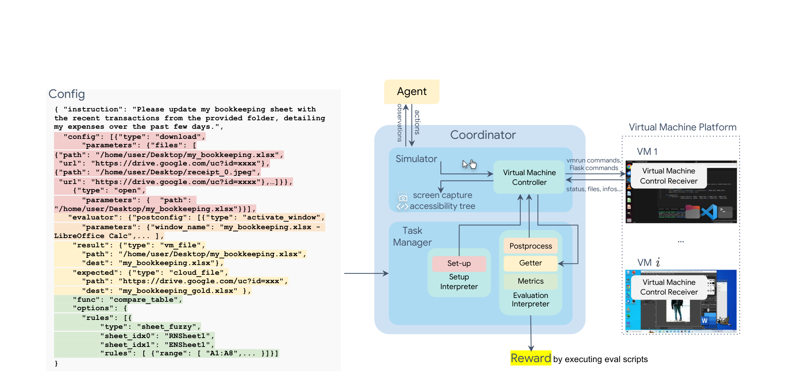
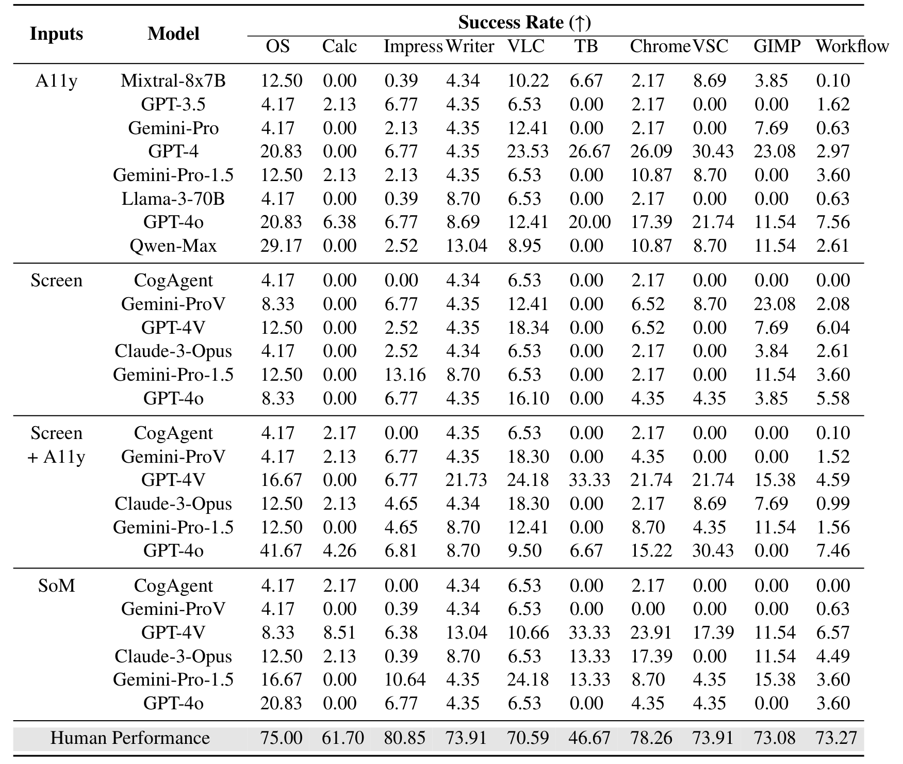
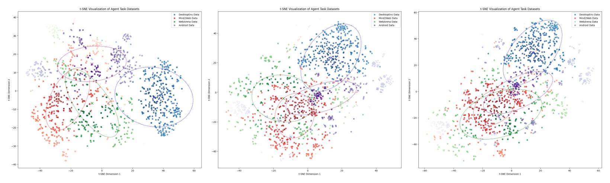

# OSWorld: Benchmarking Multimodal Agents for Open-Ended Tasks in Real Computer Environments

## 核心信息

- 标题：OSWorld: Benchmarking Multimodal Agents for Open-Ended Tasks in Real Computer Environments
- 标题翻译：OSWorld：面向真实计算机环境中开放式任务的多模态智能体基准
- 作者：Tianbao Xie、Danyang Zhang、Jixuan Chen、Xiaochuan Li、Siheng Zhao、Ruisheng Cao、Toh Jing Hua、Zhoujun Cheng、Dongchan Shin、Fangyu Lei、Yitao Liu、Yiheng Xu、Shuyan Zhou、Silvio Savarese、Caiming Xiong、Victor Zhong、Tao Yu
- 机构：香港大学（XLANG Lab）、卡内基梅隆大学、Salesforce Research、滑铁卢大学
- 发表时间：2024-04（arXiv 初版）；2024-12（NeurIPS 2024）
- 发表渠道：NeurIPS 2024 Datasets and Benchmarks Track
- arXiv：2404.07972
- 论文链接：https://arxiv.org/abs/2404.07972
- 代码 / 项目：https://github.com/xlang-ai/OSWorld ；https://os-world.github.io
- 数据 / 资源：369 个 Ubuntu 任务与 43 个 Windows 任务，含初始状态配置、评测脚本与 VM 环境，Apache-2.0 许可
- 论文类型：benchmark / dataset（可执行评测环境）

## 原文摘要翻译

能够以最少人工干预完成复杂计算机任务的自主智能体，可以显著提升人机交互的可及性与生产力。现有基准要么缺乏交互式环境，要么局限于特定应用或领域，无法反映真实计算机使用的多样性与复杂性，也限制了智能体的可扩展性。我们提出 OSWorld，这是首个同类、可扩展的真实计算机环境，面向多模态智能体，支持在 Ubuntu、Windows 和 macOS 上对开放式计算机任务进行任务设置、交互式学习和基于执行的评测。借助 OSWorld，我们构建了一个包含 369 个任务的基准，涉及开放领域中的真实网页与桌面应用、操作系统文件 I/O 以及多应用工作流。每个样例都来自真实使用场景，并包含详细的初始状态设置与基于执行的评测，以保证可复现性。对最先进 LLM/VLM 智能体在 OSWorld 上的广泛评测，揭示了它们作为计算机助手的能力缺陷。人类可以完成 72.4% 的任务，而最好的智能体仅达到 <12.2%，尤其在 GUI grounding 与操作知识方面举步维艰。基于 OSWorld 的综合分析，为开发多模态通用智能体提供了以往基准无法提供的宝贵洞见。实现与实验见 https://os-world.github.io。

## 创新点

### 1. 把真实操作系统变成可复现的实验环境

论文用虚拟机、快照、配置文件和控制器把完整桌面封装成可重置的环境，支持任务初始化、交互和基于执行的评测，并能在单台主机上并行、无头运行。相对只在浏览器或单一应用内模拟的基准，这一步把观测提升到完整屏幕截图，把动作提升到原始键鼠事件；它的价值不只是“更真实”，而是让“跨应用、开放终点”的任务第一次有了可重复的判定基础。

### 2. 开放式任务集而非模板题库

369 个 Ubuntu 任务与 43 个 Windows 任务覆盖浏览器、媒体播放器、邮件客户端、代码编辑器、办公套件、图像编辑器和系统工具。
具体应用包括 Chrome、VLC、Thunderbird 和 VS Code。
办公套件为 LibreOffice，另有 GIMP 与系统工具。
任务包含 268 个单应用任务、101 个多应用工作流、30 个不可行任务，并整合了 84 个来自其他基准的样例。
任务来自论坛、教程、视频和问答社区，而不是从固定模板批量生成；这使任务长度、噪声和操作组合更接近日常使用。

### 3. 执行式评测替代静态演示

每个任务都配有可执行的评测脚本，读取最终文件、cookie、a11y 树、应用配置或云盘内容，再调用 134 个不同评测函数之一判断完成度。相对“给定一条标准答案轨迹”的静态数据，这允许同一任务存在多条合法操作路径，只要最终状态满足断言；这是开放终点任务能被客观评分的关键。

### 4. 中间初始状态

任务常常从“做到一半”的状态开始：文件已经打开、邮箱已经登录、幻灯片停在第 5 页、表格已有部分数据。论文为此设计了 302 个不同初始状态，并用快照、下载文件和预处理命令复现。这比“从空白桌面开始”更接近人类真正求助的时刻，也把状态恢复能力纳入了评测范围。

### 5. 系统性的能力诊断

论文不仅报告一个总分，还给出人类基线、12 个以上模型、4 种输入设置，以及分辨率、历史长度、窗口扰动、跨操作系统迁移和失败案例的分类分析。它把“智能体还差多远”拆成可定位的子问题：差在感知、grounding、软件知识，还是长程状态管理。

## 一句话总结

OSWorld 用 VM 快照、原始键鼠动作和逐任务执行式脚本，把真实电脑上的开放式任务做成可复现基准；在 369 个任务上人类完成 72.36%，最强智能体只有 12.24%，差距主要落在 GUI grounding 与软件操作知识，而不是任务理解。

## 研究问题

### 既有基准缺了什么

论文把缺口拆成五个维度，下面的对照也解释了为什么“再做一个网页基准”不够：

| 维度 | 既有工作的典型做法 | 造成的评测盲区 |
|---|---|---|
| 交互性 | 静态演示数据，不含可执行环境 | 无法探索、无法交互学习、无法从反馈中恢复 |
| 开放性 | 单网站、单应用或单领域 | 无法测跨应用工作流和开放终点任务 |
| 动作空间 | 简化 DOM 操作或专用 API | 右键、组合键、拖拽、跨窗口切换被排除 |
| 评测 | 单一答案或人工检查 | 无法容纳多解，也难以规模化复现 |
| 初始状态 | 从空白桌面开始 | 不真实，绕开了“做到一半”的状态恢复 |

### 论文要回答的四个问题

1. 环境问题：能否用真实操作系统、虚拟机和原始键鼠，构建可扩展、可复现、可并行的开放式任务环境？
2. 评测问题：执行式脚本能否在跨应用、开放终点的任务上稳定判定成功，而不是只认一条轨迹？
3. 能力问题：当前最强的 LLM/VLM 智能体距离人类计算机助手还有多远，瓶颈在感知、grounding 还是操作知识？
4. 设计问题：a11y 树、截图、SoM、历史长度和分辨率这些接口选择，会怎样改变智能体的表现？

## 数据与任务定义

### 任务形式化

论文把数字智能体任务写成目标增强的部分可观测马尔可夫决策过程：

$$\mathcal{M} = (\mathcal{S}, \mathcal{O}, \mathcal{A}, T, \Omega, r, \gamma, \rho_0, \mathcal{G}, p_g, \phi)$$

其中，$\mathcal{S}$ 是包含隐藏系统状态的完整状态空间，$\mathcal{O}$ 是观测空间。
$\mathcal{A}$ 是动作空间。
$T$ 是状态转移函数，$\Omega$ 是观测函数，$r$ 是奖励，$\gamma$ 是折扣因子。
$\rho_0$ 是初始状态分布，$\mathcal{G}$ 是目标空间（这里就是自然语言指令），$p_g$ 是目标分布。
$\phi$ 把观测映射到目标。

在每一步 $t$，智能体看到观测 $o_t$，它由指令加上截图、a11y 树或终端输出组成。
智能体据此输出可执行动作 $a_t$，例如右键点击或打开终端。
环境执行动作后转移到 $s_{t+1}$，并返回新的观测 $o_{t+1}$。
交互在智能体输出 DONE/FAIL 或达到最大步数（实验设为 15 步）时结束。
奖励只在最终步给出：

$$r(s, a, g) \in [0, 1]$$

完全达成目标记 1，部分达成记小于 1 的正数，不可行任务上正确预测失败也可得分，其余情况为 0。这个设计把“任务是否完成”与“路径是否标准”解耦，是后面执行式评测能够容纳多解的形式基础。

### 观测空间

观测有三类：完整桌面截图、a11y 树和终端输出。
截图默认 1920×1080，包含鼠标指针的位置和形状。
a11y 树由 Ubuntu 的 pyatspi 或 Windows 的 pywinauto 生成，再转成 XML 传递。
原始 a11y 树通常超过 100 万 tokens，论文按标签、可见性、可用性、名称、位置和尺寸过滤。
过滤后只保留 tag、name、text、position、size 五个字段。
单步观测的 90 分位仍约 6343.6 tokens，这个数字直接决定了长上下文和推理成本，也是后文“a11y 有效但昂贵”的依据。
论文还实现了视频录制，但没有纳入建模。

### 动作空间

动作空间以 pyautogui 的调用为语法：移动、左/右/中键点击、多击、拖拽、滚动、按键、组合键、按下/抬起，覆盖了常见的键盘与鼠标操作。论文另外提供 `computer_13` 变体，把动作收敛成 13 种带参数的类型，方便强化学习；并在两者之上加入 WAIT、FAIL、DONE 三个特殊动作，分别表示等待、判定不可行和判定完成。

与 WebArena 一类网页基准相比，这个动作空间的关键增量是右键、按住 ctrl 多选、拖拽和跨窗口切换。它们看似细枝末节，却决定了很多桌面任务能否完成，也为智能体学习设定了更高的上限。

### 任务来源与构成

任务来自官方文档与教程、视频平台和问答社区。
具体包括 YouTube、TikTok、WikiHow 等教程来源。
也包括 Reddit、Quora、Superuser、StackOverflow 等问答社区，以及 Coursera、Udemy 等课程。
作者按流行度、有用性和多样性筛选，再对多应用任务进行组合与改写；每个样例由另外两名作者交叉检查可行性、歧义和来源一致性。
除了可行任务，论文还刻意保留 30 个因功能下线或用户臆想而不可行的任务，用来测试智能体能否识别“这件事做不到”。

| 统计项 | 数量 |
|---|---|
| Ubuntu 任务 | 369 |
| 单应用任务 | 268（72.6%） |
| 多应用工作流 | 101（27.4%） |
| 整合自其他基准 | 84（22.8%） |
| 不可行任务 | 30（8.1%） |
| Windows 任务 | 43 |
| 不同初始状态 | 302 |
| 不同执行式评测函数 | 134 |

按应用类别，Office 占 31.7%，Workflow 占 27.4%。
Daily 占 21.1%，Professional 占 13.3%，OS 占 6.5%。
Office 是最大的一块，也是后文智能体表现最差的一块。
这个分布本身就预示了总分会被 GUI 密集任务拉低。

### 标注与质控

9 位计算机专业的学生作者用 3 个多月完成标注，总计约 1800 人时：650 小时用于单应用任务，750 小时用于工作流任务，400 小时用于双重检查。任务收集另花约 400 小时；每个样例的初始状态设计约 1 小时，评测设计约 2 小时。标注完成后，每个样例由两名未参与标注的作者以智能体身份实际尝试，反馈给标注者修订；在人类性能和基线实验期间又进行了四轮检查，累计超过 400 小时。这个成本结构说明：这类基准的瓶颈不是模型，而是高质量初始状态和评测脚本的人工投入。

## 方法主线

### 构建流程

论文的构建流程可以还原为四步，每一步都有明确的输入、操作和输出：

1. **任务采集与改写**：输入是论坛、教程、视频和课程中的真实问题；操作是按流行度、有用性和多样性筛选，把单应用问题组合成跨应用工作流，并补齐指令、文件与场景；输出是自然语言指令和任务素材。
2. **初始状态设计**：输入是任务指令；操作是启动指定 VM 并回滚到快照，下载并打开任务文件，执行额外预处理（例如把 Impress 翻到第 5 页、点击回到主界面）；输出是可复现的中间状态和对应的 config 文件。
3. **评测脚本编写**：输入是任务目标和初始状态；操作是定义后处理（激活窗口、保存文件）、结果获取（文件、cookie、a11y 树、云盘内容）和断言函数；输出是可执行的 evaluator 配置，最终汇成 134 个评测函数。
4. **质量复核**：输入是完整样例；操作是让两名未参与标注的作者实际执行，记录歧义、崩溃、假阳性和假阴性，再进行四轮修订；输出是进入基准的最终任务集。

### 评测协议

一次完整评测按下面的链路执行：

1. **配置**：读取任务的 instruction、config 和 evaluator。
2. **初始化**：VM 回滚到快照，按 config 下载文件、打开应用、调整窗口和界面状态。
3. **交互**：智能体在最多 15 步、30 分钟内输出 pyautogui 代码或特殊动作；环境执行后返回新的截图、a11y 树或终端输出。
4. **后处理**：激活指定窗口、保存文件、导出 cookie 或读取应用配置。
5. **获取与判定**：getter 把结果文件、云盘文件、a11y 树或配置读出来，交给 evaluator 的函数和参数进行比对。
6. **奖励**：完全匹配记 1，部分匹配记小于 1 的正数，不可行任务上正确 FAIL 也可得分，其余为 0。

*论文原图编号：Figure 2 — OSWorld 基础设施总览：Config、Coordinator、VM 平台与执行式奖励链路。*

图 2 值得仔细看的地方在于：配置不只是“打开哪个文件”，它同时承载了初始状态、后处理和评测期望。
协调器把模拟器、虚拟机控制器和任务管理器分开，使多个虚拟机可以并行。
奖励不是模型打分，而是执行评测脚本得到的。
这三件事共同决定了基准的可复现性。

表 1 给了三个评测例子：删除 Amazon 的 cookie 用 `get_cookie_data` 加域名规则；重命名并复制工作表用 `get_file` 加 `compare_table` 的 `sheet_name` 和 `sheet_data` 规则；检查邮件收件人用 `get_a11y_tree` 加选择器规则。可以看到，评测并不要求智能体走某条固定路径，而是检查最终文件、浏览器状态或界面结构是否满足断言。

### 观测与输入设置

论文比较了四种输入：

- **a11y 树**：过滤后的结构化文本，保留标签、名称、文本、位置和尺寸，适合纯文本 LLM；坐标直接来自树节点。
- **截图**：1920×1080 原始屏幕，适合 VLM；坐标需要模型自己从像素推断。
- **截图 + a11y**：同时给视觉和结构信息，试图兼顾通用性与 grounding。
- **Set-of-Mark**：用过滤后的 a11y 树在截图上画编号框，并附上 index、tag、name、text 的表格；模型输出编号而不是坐标，后处理再映射回动作。

四种设置的提示、坐标映射和后处理并不完全一致，这一点在后文比较结果时必须记住：输入表示的效果与具体实现是纠缠的，不能把差异全部归因于“模态”。

### 基线设置

论文评测的文本模型包括 Mixtral-8x7B、Llama-3-70B、GPT-3.5、GPT-4。
闭源模型包括 Gemini-Pro、Gemini-Pro-1.5、Qwen-Max 和 GPT-4o。
视觉模型包括 CogAgent、GPT-4V、Gemini-ProV 和 Claude-3-Opus。
补充实验还加入了 GPT-4o-mini、InternVL2、MiniCPM-V-2.6 和 Llava-OneVision。
所有模型使用 temperature 1.0、top-p 0.9，最多生成 1500 tokens。
提示里保留最近 3 组观测-动作对，最大交互 15 步、30 分钟。
闭源模型固定到 2024 年 4 月的 API 版本，例如 gpt-4-0125-preview 和 gpt-4-vision-preview。

## 关键结果

### 人类与智能体的断层

表 5 的主结果可以压缩成下面这张表。列的顺序是 OS、Office、Daily、Professional、Workflow 和总体；人类行给出人类在同一套评测脚本下的表现。

| 输入 | 模型 | OS | Office | Daily | Professional | Workflow | 总体 |
|---|---|---|---|---|---|---|---|
| 人类 | — | 75.00 | 71.79 | 70.51 | 73.47 | 73.27 | **72.36** |
| a11y | GPT-4 | 20.83 | 3.58 | 25.64 | 26.53 | 2.97 | **12.24** |
| a11y | GPT-4o | 20.83 | 6.99 | 16.81 | 16.33 | 7.56 | 11.36 |
| a11y | Qwen-Max | 29.17 | 3.58 | 8.36 | 10.20 | 2.61 | 6.87 |
| a11y | Gemini-Pro-1.5 | 12.50 | 2.56 | 7.83 | 4.08 | 3.60 | 4.81 |
| 截图 | GPT-4V | 12.50 | 1.86 | 7.58 | 4.08 | 6.04 | 5.26 |
| 截图 | Gemini-ProV | 8.33 | 3.58 | 6.55 | 16.33 | 2.08 | 5.80 |
| 截图 | Claude-3-Opus | 4.17 | 1.87 | 2.71 | 2.04 | 2.61 | 2.42 |
| 截图 + a11y | GPT-4V | 16.66 | 6.99 | 24.50 | 18.37 | 4.64 | 12.17 |
| 截图 + a11y | GPT-4o | 41.67 | 6.16 | 12.33 | 14.29 | 7.46 | 11.21 |
| SoM | GPT-4V | 8.33 | 8.55 | 22.84 | 14.28 | 6.57 | 11.77 |

最强的 GPT-4 + a11y 只有 12.24%，约为人类 72.36% 的六分之一。
这个差距不是“再涨几个点”的量级：即便把所有模型的最好类别挑出来，也没有任何一个模型在任何一大类上接近人类。
更值得注意的是类别间的方差——GPT-4 在 OS 类有 20.83%、Professional 有 26.53%，但 Office 只有 3.58%。
人类则在五个类别上都稳定在 70% 左右，波动不到 5 个百分点。
这说明智能体的失败不是均匀分布的，而是集中在 GUI 密集、需要软件操作知识的地方。

人类侧还有两个数字值得记住：中位操作时间 111.94 秒，而 WebArena 对照只有 35.38 秒；人类准确率 72.36%，WebArena 对照为 88%。也就是说，OSWorld 的任务不仅更长，而且即便对人类也更容易出错。

> [!figure] Figure 4 人类操作时间与准确率
> 建议位置：关键结果 / 人类与智能体的断层
> 放置原因：原图把 OSWorld 与 WebArena 的操作时间分布和准确率放在一起，是说明任务更难、更耗时的直接证据；但当前裁剪混入表 4 与正文，保留占位。
> 当前状态：占位符保留；裁剪混入相邻表格与正文，视觉质量不合格。

### 按应用：Office 是重灾区

*论文原图编号：Table 13 — 按应用细分的成功率与人类表现。*

表 13 按列读，会看到几个很具体的模式。
Calc 对大多数模型是 0%，只有 GPT-4o 在 a11y 下有 6.38%、在截图 + a11y 下有 4.26%。
Impress 和 Writer 略好，但也在个位数徘徊。
Chrome 和 VLC 相对高，GPT-4 a11y 下分别有 26.09% 和 23.53%。
Thunderbird 在 GPT-4 a11y 下有 26.67%，但多数模型接近 0%。
人类侧则相反：Calc 61.70%、Impress 80.85%、Writer 73.91%、VLC 70.59%。
Chrome 78.26%、VS Code 73.91%、GIMP 73.08%，Thunderbird 只有 46.67%。
对人类最难的是邮件客户端，对智能体最难的却是电子表格和演示文稿——这个反差本身就是“操作知识”与“视觉 grounding”双重瓶颈的证据。

### 难度、可行性与跨应用

表 15 用 GPT-4V + SoM 这一最强配置之一，把成功率按难度、可行性和应用数量拆开：

| 子集 | 占比 | 成功率 |
|---|---|---|
| Easy（人类 0–60 秒） | 28.72% | 16.78% |
| Medium（60–180 秒） | 40.11% | 13.12% |
| Hard（>180 秒） | 30.17% | 4.59% |
| 不可行 | 8.13% | 16.67% |
| 可行 | 91.87% | 13.34% |
| 单应用 | 72.63% | 13.74% |
| 多应用工作流 | 27.37% | 6.57% |

三个趋势很清楚。第一，任务越长，智能体越吃力：Hard 只剩 4.59%，而人类仍有 49.57%；第二，不可行任务的成功率反而高于可行任务（16.67% 对 13.34%），说明部分模型倾向于过早输出 FAIL，靠“蒙不可行”拿到假阳性；第三，单应用的成功率是多应用的两倍以上，跨应用的状态跟踪和窗口切换是额外的难关。

> [!figure] Table 15 GPT-4V + SoM 的分层成功率
> 建议位置：关键结果 / 难度、可行性与跨应用
> 放置原因：按难度、可行性和应用数量拆分的成功率，是“长任务与多应用更难”的直接证据；正文已用 Markdown 表复述数值，图位保留。
> 当前状态：占位符保留；裁剪左侧混入正文，未物化。

### 输入设置：没有万能表示

把同一个模型放在四种输入下比较，比看单个总分更有信息量：

| 模型 | a11y | 截图 | 截图 + a11y | SoM |
|---|---|---|---|---|
| GPT-4V | — | 5.26 | 12.17 | 11.77 |
| GPT-4o | 11.36 | 5.03 | 11.21 | 4.59 |
| Claude-3-Opus | 2.42 | 2.42 | 4.41 | 6.72 |

GPT-4V 从纯截图的 5.26% 提升到截图 + a11y 的 12.17%，说明结构信息确实补上了视觉 grounding 的短板。
但 GPT-4o 在 SoM 下掉到 4.59%，比它自己的 a11y 设置低了近 7 个百分点。
Claude 则相反，从纯截图的 2.42% 升到 SoM 的 6.72%。
同一个接口，对不同模型可能是助力，也可能是干扰。
论文的结论“a11y 和 SoM 的效果因模型而异”是有数据支撑的，但更准确的说法是：这些接口改变了模型需要解决的任务难度，而不同模型的归纳偏置不同。

### 跨系统迁移与成本

论文把 43 个 Ubuntu 任务改写后迁移到 Windows，用 GPT-4V 纯截图重新评测：Ubuntu 4.88%，Windows 2.55%，两者的任务难度排序相关系数为 0.7。绝对值都低，但排序相关说明“哪些任务难”在系统之间有一定一致性；这只能支持“相对难度可迁移”，不能支持“智能体已经跨系统通用”。

| 设置 | 预计耗时 | 全量成本 | 10% 子集成本 |
|---|---|---|---|
| GPT-4V 纯截图 | 10 小时 | 100 美元 | 10 美元 |
| Gemini-ProV 纯截图 | 15 小时 | 0 美元 | 0 美元 |
| Claude-3 Opus 纯截图 | 15 小时 | 150 美元 | 15 美元 |
| GPT-4V + a11y/SoM | 30 小时 | 500 美元 | 50 美元 |

这张表对复现很重要：一次全量评测不是“跑个脚本”那么简单，而是几十小时和几百美元的预算；如果要做多随机种子、多提示、多模型，成本会迅速上升。这也许部分解释了为什么论文只报告单次运行。

## 深度分析

### 规划不弱，执行很弱

论文对 550 个失败样例做了人工分类，超过 75% 存在鼠标点击坐标错误。这个数字的含义不是“模型不会规划”——很多失败轨迹的注释里，计划写得相当合理，甚至能正确说出“点击菜单栏的 Brightness-Contrast”；问题在于把计划翻译成像素坐标时点偏了。点偏之后会引发两类连锁错误：重复点击（反复调整、反复失败，耗尽 15 步）和环境噪声（误点弹窗、广告、无关应用，状态被带偏后无法回到正轨）。

几个具体案例很能说明问题。
GIMP 调亮度的任务里，智能体知道要去 Colors 菜单，但连续点错 Brightness-Contrast、Exposure、Color Balance 的位置。
每次点错后弹窗又需要 Cancel，最后在 15 步内耗尽。
LibreOffice 居中对齐标题的任务里，它反复选中无关文字、打开无关菜单。
Claude-3 Opus 则出现更“语义级”的 grounding 幻觉——把双击文件理解成选中而不是打开，把 Calc 的 B 列当成 C 列，在查找替换里没有点全局替换。
这些都不是“不懂任务”，而是“不懂 UI 的因果语义”。

反过来，智能体在“代码可解”的任务上会超过人类：监控 CPU 30 秒、强制结束进程、用 ffmpeg 裁剪视频，这些任务可以通过一条命令完成，智能体反而比不熟悉终端的人类快。但论文也记录了一个反例：任务要求“用 GIMP 裁剪视频”，智能体直接用 ffmpeg 完成，任务虽然完成了，却违反了指令对工具的约束。这说明执行式评测的“结果正确”与“过程合规”之间仍有缝隙。

### 输入表示是一把双刃剑

a11y 树的优势是语义和坐标同时存在：模型不需要从像素猜“这个按钮在哪”，只需要在结构化列表里找到对应节点。
对纯文本 LLM，这几乎是唯一可行的 grounding 方式，GPT-4 因此拿到 12.24% 的最高分。
但代价是上下文长度：过滤后 90 分位仍有 6343.6 tokens，单步观测就要占掉大量预算，15 步轨迹很快超出常见上下文窗口。
而且 a11y 的质量随应用而异，专业软件（GIMP、VS Code 的某些面板）经常缺少清晰的 name 或 role，模型只能靠位置和文本猜。

截图的优势是通用：任何应用、任何 OS 都能截，不需要应用配合；缺点是高分辨率下的坐标回归很难，尤其是 4K 屏幕上的小控件、表格单元格和画布上的精确位置。论文的分辨率实验也印证了这一点：纯截图设置下，提高输入分辨率通常能提升成功率，因为输出坐标仍按原始 1080P 对齐，降采样会放大“看到的”和“点到的”之间的偏差。

SoM 试图折中：用 a11y 框把可交互元素标成编号，模型只输出编号，后处理映射成坐标。
它在网页类任务上有效，因为网页元素的框通常干净。
但在桌面软件里，表格的每个单元格、GIMP 的画布区域、VS Code 的设置项都可能产生大量重叠或错误的框。
论文在 D.6 里给了直接对比。
同一个“关闭 VS Code Python 插件代码检查”的任务，不带 SoM 的智能体直接改 settings.json 成功。
带 SoM 的智能体却在设置界面里找不到正确的复选框。
SoM 缩短了动作空间，也缩短了探索空间；对需要坐标级操作或深层菜单的任务，这是净损失。

### 分辨率、历史与扰动

三个消融给出了很一致的画像：当前智能体对“表面变化”很敏感，对“结构理解”很脆弱。

- **分辨率**：纯截图设置下，提高分辨率通常更好；SoM 设置下，降采样到 0.4（768×432）反而更好，继续降到 0.2 才明显变差。一个合理的解释是：SoM 的框本身已经提供了定位，适度降采样减少了噪声与词元开销；但降得太狠，框和文字都糊了。
- **历史长度**：把最近 N 轮观测-动作对放进提示，N 从 1 增到 3 再到“尽可能多”，SoM 的成功率随历史变长而上升；纯截图设置下却没有这个收益。这说明当前 VLM 从图像历史里提取上下文的能力，远弱于从文本历史里提取。
- **窗口扰动**：在一个 GPT-4V + SoM 能到 50.79% 的 28 任务子集上，改变窗口位置、把窗口缩到最小、打开无关软件并最大化，成功率分别降到 36.50%、15.04% 和 25.39%。智能体能在一定程度上切换窗口，却不会先把窗口最大化再操作；它们依赖的是训练分布里的像素布局，而不是“窗口可以被管理”这一结构知识。

| 条件 | GPT-4V + SoM 成功率 |
|---|---|
| 原始 | 50.79% |
| 改变窗口位置 | 36.50% |
| 窗口缩到最小 | 15.04% |
| 打开无关软件并最大化 | 25.39% |

这里有一个需要读者自己核对的细节：论文正文说扰动会带来“60% 甚至 80%”的下降，但按表中数值计算的相对降幅约为 28%、70% 和 50%，两者对不上。引用时建议直接使用表格数值，并注明是相对下降还是绝对百分点下降。

### 这个基准真正测到了什么

OSWorld 测的是“在给定观测/动作接口和 15 步预算下，智能体能否把真实应用推到满足断言的状态”。它不是一个通用的“计算机智能”测试，也不是对单一能力的隔离测量。更准确地说，它测的是端到端任务成功率，其中混合了感知、grounding、软件知识、长程状态管理、错误恢复和终止判断。

这带来几个构念效度上的边界：

- **任务集是策展样本，不是概率抽样**。369 个任务覆盖 8 类软件，但真实计算机使用的长尾远不止这些；论文也承认代表性没有经过统计验证。
- **评测脚本只认预设最终状态**。它允许不同的操作路径，但不允许不同的“正确终态”表述；一个合法的替代解法（例如用公式而不是手动填值）可能被判错。论文并未披露脚本的假阳性/假阴性率。
- **15 步上限与人类不对称**。人类中位操作时间是 111.94 秒，很多任务需要几十次点击；智能体只有 15 步，长任务被系统性压缩。论文说 15 步“对大多数任务足够”，但缺少步数消融来支撑这个判断。
- **单次运行，没有方差**。所有成功率都是点估计，没有置信区间、随机种子或提示重复；模型间 1 到 2 个百分点的差异可能落在噪声里。
- **闭源 API 会漂移**。2024 年 4 月的 gpt-4-vision-preview 与今天的同名服务端行为未必一致，精确复现需要固定快照或本地权重。
- **安全副作用没有被测量**。评测只看任务是否完成，不看是否误删文件、误发邮件、改了系统设置；论文在局限里明确承认这一点。

可以把这个基准的“能证明/不能证明”压缩成一张对照：

| 论文能支持的结论 | 论文不能支持的结论 |
|---|---|
| 在 8 类真实应用、369 个任务上，当前模型的端到端成功率远低于人类 | 当前模型在所有计算机任务上都只有 12% 的水平 |
| GUI grounding 和软件操作知识是主要失败来源 | 只要解决 grounding，智能体就能达到人类水平 |
| a11y、截图、SoM 的效果因模型和任务而异 | 某一种输入表示在原则上优于其他表示 |
| 多应用、长任务、GUI 密集任务更难 | 难度差异完全由跨应用推理造成 |
| 跨 OS 的任务难度排序有相关性 | 智能体已经具备跨 OS 的通用能力 |

### 与相关基准的定位

| 基准 | 实例数 | 环境 | 跨应用 | 中间初始状态 | 执行式评测函数 |
|---|---|---|---|---|---|
| WebArena | 812（241） | Web | 否 | 否 | 5 |
| VisualWebArena | 910（314） | Web | 否 | 否 | 6 |
| MiniWoB++ | 125 | Web | 否 | 否 | 125 |
| OSWorld | 369 | 计算机 | 是 | 是 | 134 |

OSWorld 的差异化不在规模：GAIA 有 30k 实例，WorkArena 有 23k。
OSWorld 只有 369 个任务。
它的价值在于“真实 OS + 原始键鼠 + 跨应用 + 中间初始状态 + 134 个执行式函数”这个组合。
对需要控制变量的研究，WebArena 仍然是更干净的网页实验床；对需要研究真实桌面操作和跨应用迁移的工作，OSWorld 更合适。
两者不是替代关系，而是不同抽象层级的工具。

*论文原图编号：Figure 7 — 任务指令分布的降维对比。*

图 7 用 t-SNE 把 OSWorld 的指令分布与几个数字智能体数据集放在一起。作者想说明 OSWorld 的语义分布更分散、与其他基准的聚类中心不重合；从图上看，OSWorld 的点确实覆盖了更宽的区域，但 t-SNE 的邻域结构对超参数敏感，这张图适合做定性佐证，不适合当作“覆盖度”的定量证明。

### 复现与工程注意点

如果要在自己的环境里复现，下面这些点比读主结果更容易踩坑：

- **VM 与快照**：论文用 VMware 的 vmrun 和 Flask 控制器管理 VM，任务初始化依赖快照回滚。快照必须和任务配置版本匹配，否则初始状态会漂移。
- **动作与观测依赖**：pyautogui 负责动作，pyatspi 与 pywinauto 负责 a11y。
- **浏览器依赖**：Playwright 加 socat 负责 Chrome。
- **文件与图像依赖**：openpyxl、python-docx、python-pptx 负责 Office 文件，Pillow 负责图像。
- **Windows 依赖**：Ncat 负责端口转发，Office 需要授权。
- **其他依赖**：OpenCV 与 EasyOCR 出现在环境依赖清单中。
- **坐标与分辨率**：截图默认 1920×1080，但 VM 可以改分辨率；改分辨率会同时影响模型输入和动作坐标，做消融时要固定一条链路。
- **后处理不能省**：很多任务在评测前需要激活窗口、保存文件、导出 cookie；漏掉后处理会让正确操作也被判 0。
- **并行与超时**：单机多 VM 可以并行，但每个 VM 都要独立的快照和端口；30 分钟超时是必要的，否则智能体可能把环境卡死。
- **统计设计**：至少跑 3 个种子或 3 次重复，报告均值与置信区间；按应用、难度、可行性分层报告，不要只报总分。

### 可迁移的研究启示

1. **把规划与 grounding 拆开**：让模型先输出“点哪个元素”的语义描述，再用专门的 grounding 模块（a11y 查询、局部放大、OCR、坐标校验）落到像素，可能比端到端输出坐标更稳。
2. **按可用性路由观测**：有 a11y 时优先用 a11y，缺失时回退截图，小目标再局部放大；不要在所有应用上强制同一种表示。
3. **补软件操作知识**：失败案例里大量是“不知道这个功能在哪个菜单”，这类知识可以通过检索官方文档、菜单树或少量演示注入，而不是只靠模型预训练。
4. **训练记忆与反思**：文本历史对 SoM 有稳定收益，说明轨迹压缩、关键状态摘要和失败反思是值得做的方向；图像历史目前收益不明显。
5. **把鲁棒性做成固定评测项**：窗口位置、尺寸、无关窗口、弹窗、分辨率变化都应该是标准扰动，而不是附录里的额外实验。
6. **同时测“做完”和“做对”**：执行式评测要加副作用检查（误删、误发、越权），否则“完成任务”可能以破坏环境为代价。

## 局限

### 论文自述的局限

论文在附录 F 里列了四个方向。
第一，提升 VLM 的 GUI 交互效率与长上下文能力，让 grounding 对窗口变化更鲁棒，并支持用图像编码历史。
第二，设计更好的探索、记忆和反思机制，以及面向 GUI 与 CLI 的智能体协议。
第三，建立真实环境中的安全性评估；目前只能靠 VM 隔离，缺少对副作用和潜在破坏行为的度量。
第四，扩展数据与环境到医疗、教育、工业、交通等专业领域，并解决 a11y 质量参差和低成本数据采集问题。

平台层面还有几个硬约束。
macOS 理论上支持，但在非 Apple 硬件上安装 macOS 涉及版权，论文并未构建 macOS 任务集。
Windows 只有 43 个任务，且 Office 需要授权。
Ubuntu 是主战场，369 个任务里有 84 个整合自其他基准。
任务来源是公开教程和论坛，外部链接可能失效，论文也没有公开包含外部资源的完整归档版本。

### 读者补充的边界

- **步数预算不对称**：15 步对真人来说远远不够，人类中位操作时间 111.94 秒、很多任务超过 900 秒。没有步数消融，就无法判断“能力不足”里有多少是“预算不足”。
- **单次运行、无置信区间**：模型间 1 到 2 个百分点的差异不宜过度解读；尤其是 GPT-4 的 12.24% 与 GPT-4V 的 12.17%，在单次运行下基本不可区分。
- **评测脚本的单路径风险**：脚本按预设终态断言，可能把合法替代解判错，也可能放过“局部正确”；论文并未披露人工审计的假阳性/假阴性率。
- **任务集不代表真实分布**：8 类应用、369 个任务、Ubuntu 主导，离“任意应用、任意 OS”还很远；论文自己说代表性没有经过统计验证。
- **“支持 macOS”是环境能力，不是基准覆盖**：读者不应把摘要里的三系统支持理解为三系统都有任务集。
- **没有训练实验**：论文强调环境支持交互式学习，但主实验只做零样本评测，没有验证“在这个环境里训练能否提升”。
- **数字口径不一致**：摘要说最好智能体低于 12.2%，表 5 中 GPT-4 + a11y 是 12.24%；正文说工作流最高 6.57%，表 5 中 GPT-4o + a11y 是 7.56%；扰动实验正文说下降 60% 到 80%，按表中数值算约为 28%、70%、50%。这些不影响主结论，但引用时要写清口径。
- **人类基线是“不熟悉软件”的计算机专业学生**：这有意模拟普通用户，但不能代表专家；专家在 GIMP、Calc 上的表现会更高，人与智能体的差距会更大。

## 我的笔记

### 复现清单

| 项目 | 关键点 | 备注 |
|---|---|---|
| 环境 | Ubuntu 22.04 VM、VMware 快照、Flask 控制器、1920×1080 | 快照与任务配置要版本对齐 |
| 任务 | 369 个 config/evaluator；先跑 10% 子集 | 先验证后处理与评分链路 |
| 观测 | 截图 + 过滤后的 a11y 树 | 记录每步 tokens，避免超上下文 |
| 动作 | pyautogui 代码、WAIT/FAIL/DONE | 沙箱执行，设置超时与异常捕获 |
| 评测 | 后处理、getter、evaluator 三段 | 保留结果文件，便于人工复核 |
| 预算 | 10–30 小时、0–500 美元/全量 | 多模型多设置要乘倍数 |
| 统计 | ≥3 次重复、均值与置信区间 | 按应用/难度/可行性分层 |

### 可做的后续实验

1. **步数消融**：固定模型和设置，把 15 步改成 15/30/50/自适应，看 Hard 和 Workflow 子集的提升曲线。这能直接回答“差距有多少来自预算”。
2. **grounding 模块**：在输出坐标前加入“局部放大 + OCR + a11y 校验”，比较端到端坐标与两阶段坐标的成功率，尤其是在 Calc 单元格和 GIMP 画布上。
3. **观测路由**：训练一个轻量分类器判断当前应用/任务是否适合 a11y、截图或 SoM，再按路由选择输入；这比全局固定一种表示更接近实际。
4. **评测脚本审计**：抽 50 个任务，让两个人独立完成并记录所有合法终态，统计脚本的假阳性/假阴性率；这会直接决定基准的可信度。
5. **小规模训练**：用 369 个任务的轨迹做监督微调或拒绝采样，留出未见过应用做迁移测试，验证“环境能否产生可迁移的能力”。
6. **安全副作用**：在评测里加入文件完整性、邮件发送、系统设置变更的检查，把“完成任务”扩展为“安全地完成任务”。

### 与其他工作的连接

- **WebArena / VisualWebArena**：网页任务的受控实验床，适合研究 DOM 与视觉 grounding；OSWorld 把同样的思路推到桌面和跨应用。
- **Mind2Web**：静态演示数据，适合训练，不适合评测交互；OSWorld 的执行式评测正好补上这一块。
- **MiniWoB++**：合成网页任务，规模小、可控性强，适合做机制分析；OSWorld 更接近真实噪声。
- **AgentBench**：多环境智能体评测，强调任务多样性；OSWorld 把“操作系统”本身作为统一环境。
- **GAIA**：通用助手任务，规模大但多为问答式；OSWorld 强调真实 GUI 操作和文件系统状态。
- **CogAgent / Set-of-Mark**：GUI 专用视觉模型与视觉提示方法，是 OSWorld 基线的重要组成，也说明“通用 VLM + 提示”仍有很大空间。

## 引用

- Tianbao Xie, Danyang Zhang, Jixuan Chen, et al. OSWorld: Benchmarking Multimodal Agents for Open-Ended Tasks in Real Computer Environments. NeurIPS 2024 Datasets and Benchmarks Track. arXiv:2404.07972. https://arxiv.org/abs/2404.07972
- OSWorld 项目主页. https://os-world.github.io
- OSWorld 代码仓库. https://github.com/xlang-ai/OSWorld
- Shuyan Zhou, Frank F. Xu, Hao Zhu, et al. WebArena: A Realistic Web Environment for Building Autonomous Agents. arXiv:2307.13854. https://arxiv.org/abs/2307.13854
- Jing Yu Koh, Robert Lo, Lawrence Jang, et al. VisualWebArena: Evaluating Multimodal Agents on Realistic Visual Web Tasks. arXiv:2401.13649. https://arxiv.org/abs/2401.13649
- Xiang Deng, Yu Gu, Boyuan Zheng, et al. Mind2Web: Towards a Generalist Agent for the Web. arXiv:2306.06070. https://arxiv.org/abs/2306.06070
- Evan Zheran Liu, Kelvin Guu, Panupong Pasupat, et al. Reinforcement Learning on Web Interfaces Using Workflow-Guided Exploration. arXiv:1802.08802. https://arxiv.org/abs/1802.08802
- Xiao Liu, Hao Yu, Hanchen Zhang, et al. AgentBench: Evaluating LLMs as Agents. arXiv:2308.03688. https://arxiv.org/abs/2308.03688
- Grégoire Mialon, Clémentine Fourrier, Craig Swift, et al. GAIA: A Benchmark for General AI Assistants. arXiv:2311.12983. https://arxiv.org/abs/2311.12983
- Jianwei Yang, Hao Zhang, Feng Li, et al. Set-of-Mark Prompting Unleashes Extraordinary Visual Grounding in GPT-4V. arXiv:2310.11441. https://arxiv.org/abs/2310.11441
