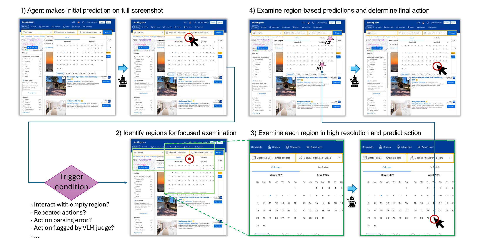
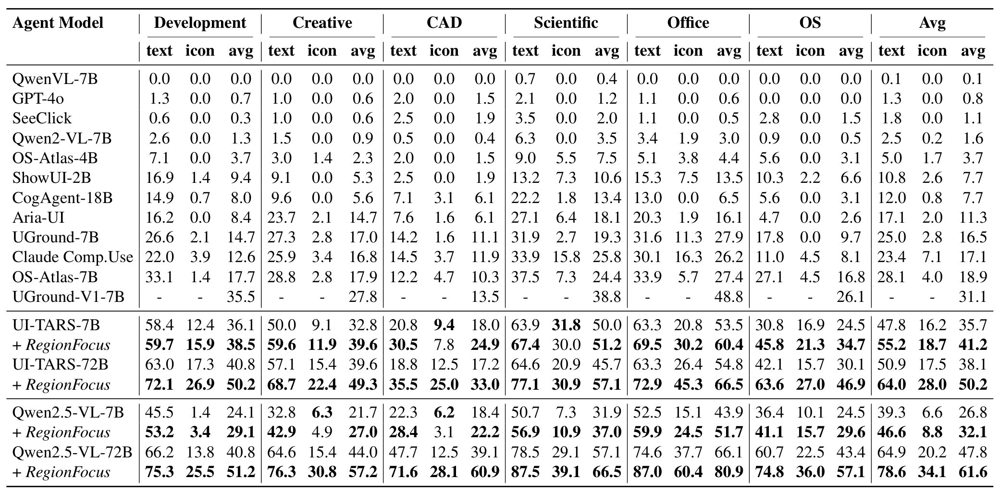
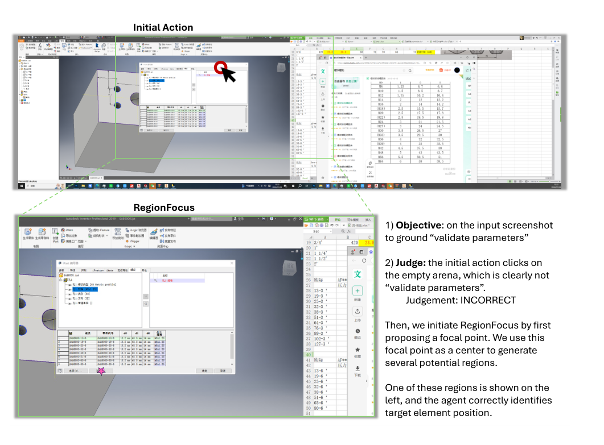
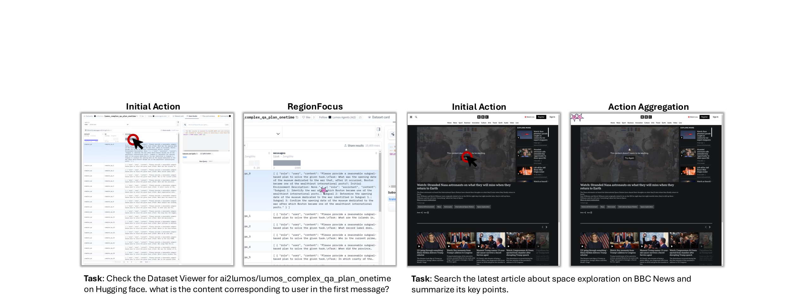
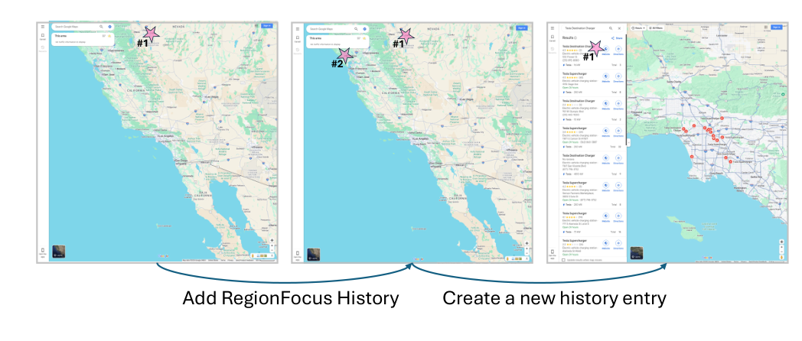

# Visual Test-Time Scaling for GUI Agent Grounding

## 核心信息

- 标题：Visual Test-Time Scaling for GUI Agent Grounding
- 标题翻译：面向 GUI 智能体定位的视觉测试时扩展
- 作者：Tiange Luo、Lajanugen Logeswaran、Justin Johnson、Honglak Lee
- 机构：密歇根大学（University of Michigan）；LG AI Research
- 发表时间：2025
- 发表渠道：ICCV 2025（IEEE/CVF International Conference on Computer Vision）
- DOI：10.1109/ICCV51701.2025.01859
- 论文链接：https://doi.org/10.1109/ICCV51701.2025.01859
- 代码 / 项目：https://github.com/tiangeluo/RegionFocus
- 数据 / 资源：评测使用 ScreenSpot-Pro 与 WebVoyager 两个公开基准，未发布新数据；消融在 WebVoyager 子集上用 UI-TARS-7B-DPO 完成
- 论文类型：AI 方法（推理期插件，不训练、不改模型结构）

## 原文摘要翻译

我们提出 RegionFocus，一种面向视觉语言模型智能体的视觉测试时扩展方法。理解网页之所以困难，是因为 GUI 图像在视觉上很复杂、界面元素数量庞大，使得准确的动作选择变得困难。我们的方法动态放大到相关区域，减少背景杂乱并提升定位精度。为支撑这一过程，我们提出 image-as-map 机制，把每一步的关键地标可视化，从而给出透明的动作记录，并使智能体能够在多个动作候选中有效选择。即便使用简单的区域选择策略，我们仍在 ScreenSpot-Pro 上观察到 28+% 的性能提升、在 WebVoyager 上观察到 24+% 的提升；这两个结果建立在两个当前最优的开源视觉语言模型智能体 UI-TARS-72B 与 Qwen2.5-VL-72B 之上，凸显了视觉测试时扩展在交互式场景中的有效性。将 RegionFocus 应用于 Qwen2.5-VL-72B 后，我们在 ScreenSpot-Pro 基准上取得了 61.6% 的新最优定位性能。我们的代码公开在 https://github.com/tiangeluo/RegionFocus。

## 创新点

### 1. 把测试时扩展从"多采样文本"换成"多看一眼图像"

已有的测试时扩展主要在文本侧加算力：多采样、自我反思、推理期检索。RegionFocus 换了一个维度——不增加采样条数，而是改变模型看到的像素范围。触发错误后，模型先给一个焦点，再围绕焦点裁出若干高分辨率子区域，在每个子区域上独立预测动作。这套逻辑不需要重训模型，也不改主流程，只在推理期插入一段"重看"。

### 2. image-as-map：把空间候选与时间历史都画回图像

候选动作不以文本坐标列表呈现，而是在截图上用粉色星标加编号标出（A1、A2…）；已经尝试过的焦点也用带序号的星标标注（#1、#2…），形成一张可读的地图。模型于是不再需要把 (671, 291) 与 (671, 295) 映射到像素位置，而是直接看图选一个星标。

### 3. 用"点 + 固定框"绕开边界框回归

VLM 能比较可靠地给出目标附近的一个点，却很难直接输出准确的边界框。论文因此不让模型预测框：把点当作中心，套上固定 0.5×0.5 比例的候选框，越界时平移回屏幕内。消融显示，让模型直接预测区域会从 43.2 掉到 28.1，这一设计不是可有可无的简化。

### 4. 两套触发方式覆盖"能交互"与"只有截图"两类场景

在线网页环境用环境反馈触发：点空白、动作重复、动作解析失败都会立刻暴露。只有静态截图时，用同一个 VLM 给自己的预测打分，判定为错才触发。这让同一套机制既能跑 WebVoyager 这类真实浏览任务，也能跑 ScreenSpot-Pro 这类单步定位基准。

## 一句话总结

RegionFocus 在推理期给 GUI 智能体加一条"出错就放大重看"的回路——模型给出焦点，规则裁出 4 个高分辨率子区域分别预测动作，再在标注了星标与历史序号的整屏图上聚合；这套不改权重的机制把 Qwen2.5-VL-72B 在 ScreenSpot-Pro 上从 47.8% 推到 61.6%，把 UI-TARS-72B 在 WebVoyager 上从 44.1% 推到 59.5%，代价是每条轨迹约 67% 的额外推理调用。

## 研究问题

### 失败发生在"看清"这一步，而不是"想明白"这一步

论文的出发点是观察而非假设：现有 VLM 智能体在 GUI 上的错误，大量表现为点到空白、点到相邻元素、或反复执行同一个无效动作。作者把这些错误归因到两处。第一处是分辨率：GUI 截图元素密集、尺寸很大，整屏输入经过视觉编码器降采样后，单个图标或按钮只剩很少的像素。第二处是注意力：菜单栏、广告、推荐位与任务无关，却和目标任务共享同一张图，模型的注意力被摊薄。

文本侧的测试时扩展已经有成熟做法，例如多采样、反思、推理期检索。论文指出的缺口是：这些方法都不改变模型看到什么，只在模型"想几次"上加算力。而 GUI 的错误恰恰可能出在感知层——想得再多，看到的仍是那张被压缩过的整屏图。

由此可以拆出三个具体问题：

1. 只在出错后放大局部，能不能单独带来可测的精度提升？
2. 多个区域各自预测出候选动作后，怎么让模型在候选中做对选择？
3. 同一张图被反复放大时，怎么让模型不重复探索同一块区域？

### 为什么"再看一眼"划算

一次整屏推理的像素预算基本固定。把同样的模型调用花在几个局部区域上，等于把有效分辨率成倍提高。论文的取舍是不追求一次看全，而是在模型自己觉得不对时再看局部：这把"何时花算力"变成触发器问题，也把"花多少算力"变成可调的超参数（触发次数与区域数）。

## 数据与任务定义

### 两个基准对应两类触发

| 基准 | 场景 | 输入 | 触发方式 | 指标 |
|---|---|---|---|---|
| ScreenSpot-Pro | 桌面软件单步定位 | 静态高分辨率截图（通常大于 3k×2k） | 同一 VLM 自评：把预测点标成星标后问模型"这是不是目标元素" | 预测点是否落在目标元素框内 |
| WebVoyager | 真实网站多步任务 | Playwright 控制的 Chrome 截图 | 环境反馈：点空、动作重复、解析失败等 | 任务成功率（GPT 评委看最后 15 张截图） |

ScreenSpot-Pro 覆盖 23 个应用、5 个功能域（Development、Creative、CAD、Scientific、Office）与 3 种操作系统，任务按文本型与图标型分开统计。
WebVoyager 含 643 个任务、15 个真实网站，自动评测对每次运行重复 3 次取均值与标准差。
两个基准的差别直接决定了触发实现：一个没有环境可交互，只能靠模型自评；一个有环境，可以直接用"动作是否生效"当信号。

### 基线与被改造的模型

被改造的是 UI-TARS（7B 与 72B）与 Qwen2.5-VL（7B 与 72B），两者都是"看截图直接输出动作"的端到端智能体。
对比对象包括 GPT-4o、Claude Computer Use、SeeClick、OS-Atlas 等通用系统。
另一组对照是 UGround、ShowUI、CogAgent、Aria-UI 等定位模型与智能体。

这里有一个必须交代的比较边界：Table 1 中非 RegionFocus 的数字取自 UI-TARS 论文的原始报告，作者只用官方评测脚本跑自己的结果。因此这张表是引用值与自测值的混合，跨行比较要留余量，尤其不要把不同论文的提示词与协议当成完全一致。

### 消融设置

消融用 UI-TARS-7B-DPO 在 WebVoyager 的子集上做，默认配置为 RegionFocus 开启、最多 100 步、固定比例框、不使用 SAM。这个设置比主实验弱（更小的模型、子集、单模型），因此消融数字只能在同一张表内横向比较，不能和主表混读。

## 方法主线

### 机制流程

*论文原图编号：Figure 2 — RegionFocus 作为插件接入标准 GUI 智能体流程：出错后触发，聚焦完成再回到主流程。*

1. 输入当前截图与任务指令，主流程先给出初始动作；若命中触发条件（点空、动作重复、解析失败或自评判错），把当前截图交给 RegionFocus。
2. 输入截图与指令，模型只输出一个焦点坐标 $(x_f, y_f)$；以该点为中心生成 4 个固定 0.5×0.5 比例的候选框，越界时平移回屏幕内，得到 4 个待检查区域。
3. 输入每个区域的高分辨率子图（在线环境用真实放大视图，静态环境用裁剪上采样），各区域独立预测一个候选动作，得到 4 个候选，可并行执行。
4. 输入标注了粉色星标与动作编号的整屏截图，模型在候选动作中聚合出单步动作并交回主流程；动作未生效则把该焦点写入历史并更新星标，生效或换页则清空历史。

### 触发条件：环境反馈与模型自评

两种触发对应两种信息源。在线环境里，"点击是否让页面发生变化"是最可靠的信号：点空白、点不可交互元素、动作解析失败都会立刻暴露，不需要额外判断。静态截图没有这个信号，论文让同一个 VLM 来判断——把预测点用星标标在图上，问它这个点是不是目标任务元素。

作者承认自评并不总是准确，但实验显示模型"判得比做得准"：给出的坐标可能偏，判断"这个点对不对"却相对可靠。这个现象被称为生成-校验差距。它解释了为什么同一个模型既当选手又当裁判还能涨点，同时也意味着方法的收益上限被判定器锁住——判定器漏掉的真错误不会被修复，误判的正确预测则可能被改坏。

### 区域提案：为什么不直接预测框

论文的经验观察是：VLM 能稳定给出目标附近的一个点，但直接回归边界框很不准。于是把框的生成从模型手里拿走，只保留"点"由模型决定，框由固定比例（宽高各为整屏的一半）加越界裁剪得到。

这样做有两个后果。一是区域大小与目标大小无关，小图标和大面板用同一个框，框里可能仍包含大量无关元素。二是框的质量成为性能瓶颈之一：消融里把固定框换成 SAM 以点提示生成的框，分数从 43.2 升到 46.5，说明框还能更准，作者也把这一点留作后续。

形式化地，给定焦点 $(x_f, y_f)$ 与图像尺寸 $W \times H$，候选框为

$$B = \left[\, (x_f - 0.25W,\ y_f - 0.25H),\ (x_f + 0.25W,\ y_f + 0.25H) \,\right]$$

再把四个角裁剪到 $[0,W]\times[0,H]$ 内。论文只说明每次触发使用围绕焦点的 4 个预定义框，没有给出这四个框的具体偏移与尺寸组合，这一点只能从开源代码补齐。

### image-as-map：把候选和历史都编码进观测

image-as-map 有两种用法。用于聚合时，它把每个候选动作的坐标画成带编号的星标（A1 到 A4），模型只需回答选哪一个，把一个连续的坐标回归问题换成离散的符号选择题。用于历史时，它把每次失败的焦点画成带序号的星标（#1、#2…），模型看到的是"哪些地方已经试过"，而不是一段坐标文本。

论文明确对比过文本表示：最初用文本坐标记录历史，模型仍会反复回到相近焦点；改成图上星标后，重复探索明显减少。消融里 Text-as-History 从 43.2 掉到 37.2。作者还给了像素级的例子：两个候选点只差 4 个像素，即 (671, 291) 与 (671, 295)，文本上几乎无法区分，图上却是两个不同位置的星标。

一个容易被忽略的副作用是：星标只出现在 RegionFocus 的输入里，主流程仍看原始截图；动作生效或换页后历史清空。这保证标注不会污染常规推理，但也意味着收益依赖"重新构造一份带标注的观测"这一步，而不只是提示词改写。

> [!figure] Figure 6 聚合阶段用星标区分紧邻元素
> 建议位置：方法主线 / image-as-map：把候选和历史都编码进观测
> 放置原因：原图是空间编码最直观的例子：BBC 首页上 home 与 search 两个按钮坐标只差几个像素，聚合阶段靠星标位置而不是坐标文本区分。
> 当前状态：保留占位；提取候选只拿到局部面板，不足以稳定替换成可独立解释的整图。

### 关键实现细节

- 每次触发固定消耗 6 次模型推理：1 次焦点、4 次区域动作（可并行）、1 次聚合。
- 区域数 4 与框比例 0.5×0.5 都是超参数，论文未做敏感性分析。
- 主实验的最大步数设为 100，这里的步数指真实浏览器交互动作，不含 RegionFocus 的额外调用。
- 在线环境用 Playwright 控制的 Chrome；静态基准用官方 ScreenSpot-Pro 评测脚本判定是否命中。
- 不使用 SAM 且顺序执行区域预测时，RegionFocus 不增加额外 GPU 显存。

## 关键结果

### ScreenSpot-Pro：整体与领域级增益

*论文原图编号：Table 1 — ScreenSpot-Pro 上各模型与 RegionFocus 变体的分域精度（text / icon / avg 三列）。*

整表 22 行放不进正文，按"基线 → 加 RegionFocus"抽出四个被改造模型的领域均值：

| 模型 | Development | Creative | CAD | Scientific | Office | OS | 均值 |
|---|---|---|---|---|---|---|---|
| UI-TARS-7B | 36.1 | 32.8 | 18.0 | 50.0 | 53.5 | 24.5 | 35.7 |
| + RegionFocus | 38.5 | 39.6 | 24.9 | 51.2 | 60.4 | 34.7 | 41.2 |
| UI-TARS-72B | 40.8 | 39.6 | 17.2 | 45.7 | 54.8 | 30.1 | 38.1 |
| + RegionFocus | 50.2 | 49.3 | 33.0 | 57.1 | 66.5 | 46.9 | 50.2 |
| Qwen2.5-VL-7B | 24.1 | 21.7 | 18.4 | 31.9 | 43.9 | 24.5 | 26.8 |
| + RegionFocus | 29.1 | 27.0 | 22.2 | 37.0 | 51.7 | 29.6 | 32.1 |
| Qwen2.5-VL-72B | 40.8 | 44.0 | 39.1 | 57.1 | 66.1 | 43.4 | 47.8 |
| + RegionFocus | 51.2 | 57.2 | 60.9 | 66.5 | 80.9 | 57.1 | 61.6 |

绝对增益分别是 5.5、12.1、5.3、13.8 个百分点。涨幅最大的是 Qwen2.5-VL-72B 的 CAD 域，从 39.1 升到 60.9，涨了 21.8 个百分点；这与 CAD 界面密集的小工具条、图标极小的直觉一致。涨幅最小的是 UI-TARS-7B 的 Scientific 域，只从 50.0 升到 51.2，说明基线本来就高的地方可提升空间有限。

按文本型与图标型拆开看更有意思。Qwen2.5-VL-72B 的文本均值从 64.9 升到 78.6（+13.7 个百分点），图标均值从 20.2 升到 34.1（+13.9 个百分点）。绝对增益几乎相同，但相对提升差了一倍多：图标提升约 68.8%，文本约 21.1%。图标没有文字线索可依赖，更依赖纯视觉定位，因此从分辨率中获益更多。

还有一个值得单独记住的结论：UI-TARS-7B 加上 RegionFocus 后达到 41.2%，超过了原版 UI-TARS-72B 的 38.1%。也就是说在这个基准上，把算力花在推理期的"重看"上，比把参数放大十倍更划算。但要注意它仍低于 Qwen2.5-VL-72B 的 47.8%，跨模型家族的比较不能这样外推。

数字之外，Figure 4 给了一个可以逐步核对的样本：任务是在某个界面里定位 "validate parameters"，初始动作点在空白区域；判定为 INCORRECT 后，RegionFocus 以焦点为中心生成区域并放大，最终落到正确的输入框上。这个样本同时暴露了自评的价值与风险——判定理由是对的，但初始坐标确实是错的，判得比做得准在这里成立。

*论文原图编号：Figure 4 — ScreenSpot-Pro 上的定性样本：初始动作点空，自评判错后放大重看并落到正确元素。*

### WebVoyager：真实环境里的增益

Table 2 是跨页大表，正文只抽 Overall 一列：

| 系统 | Overall |
|---|---|
| Claude（论文复现） | 52.8% |
| GPT-4o | 55.5% |
| WebVoyager（论文复现） | 57.1% |
| Qwen2.5-VL-7B | 32.5% |
| Qwen2.5-VL-7B + RegionFocus | 41.1% |
| Qwen2.5-VL-72B | 42.4% |
| Qwen2.5-VL-72B + RegionFocus | 52.7% |
| UI-TARS-7B | 33.2% |
| UI-TARS-7B + RegionFocus | 44.7% |
| UI-TARS-72B | 44.1% |
| UI-TARS-72B + RegionFocus | 59.5% |

四个模型分别涨 8.6、10.3、11.5、15.4 个百分点，是全部结果里最整齐的一组：加插件后的 UI-TARS-72B 达到 59.5%，超过了 GPT-4o 与论文自己复现的 WebVoyager。相对提升约 24% 到 35%，摘要里的 "24+%" 对应的是 Qwen2.5-VL-72B 那一行。

论文报告的标准差在 ±0.1% 到 ±0.5% 之间。这个数字需要谨慎解读：它来自 GPT 评委对同一条轨迹评三次的抖动，不包含智能体自身的随机性。因此不能据此说"0.5 个百分点以内的差异不显著"，只能说评委判分很稳定。

> [!figure] Table 2 WebVoyager 全表
> 建议位置：关键结果 / WebVoyager：真实环境里的增益
> 放置原因：这张表是 15 个网站逐站点成功率与标准差的唯一来源，正文只抽了 Overall 一列；当前提取只得到跨页的文字碎片，无法还原表格主体。
> 当前状态：保留占位；表体缺失，未物化。

站点级还有一处和论文表述不完全一致的地方，在局限里单独列出。

### 消融到底说明了什么

| 配置 | WebVoyager 子集得分 |
|---|---|
| Image-as-Map（默认配置） | 43.2 |
| Text-as-History | 37.2 |
| Fixed-BBox（默认配置） | 43.2 |
| Predict-Region | 28.1 |
| 固定框换成 SAM 框 | 46.5 |

表里有两行其实登记的是同一个默认配置，真正有效的对照只有三组。第一组是图像化历史对文本历史，43.2 对 37.2，差 6.0 个百分点，相对提升约 16%。第二组是点加固定框对直接预测区域，43.2 对 28.1，差 15.1 个百分点，相对下降约 35%，这是全表最强的证据：模型不会给框这件事是硬约束。第三组是换更准的框，43.2 对 46.5，涨 3.3 个百分点。

> [!figure] Table 3 消融结果原表
> 建议位置：关键结果 / 消融到底说明了什么
> 放置原因：这是消融五行的原始出处，正文已用 Markdown 表复述全部数值；原表表体在提取时缺失，只剩标题行，因此保留占位以便日后回原 PDF 核对。
> 当前状态：保留占位；表体缺失，未物化。

> [!figure] Figure 7 消融示意（SAM 框与近距坐标差异）
> 建议位置：关键结果 / 消融到底说明了什么
> 放置原因：原图左右两栏分别展示 SAM 用点提示生成框，以及两个只差 4 像素的候选点在文本与图像表示下的可辨识差异，是消融结论最直接的视觉证据。
> 当前状态：保留占位；该图由左右两个子图组成，提取候选只拿到右半部分面板，无法独立解释。

### 成本：6 次调用与三个开销数字

WebVoyager 上 RegionFocus 在 61.7% 的轨迹里出现，平均每条被触发的轨迹触发 5.84 次，平均开销为每条轨迹 66.8%。其中 32.3% 的触发只发生一次，论文称这一次触发带来 83.7% 的成功率提升。ScreenSpot-Pro 上 72B 模型的触发率为 60.2%，7B 模型为 33%，开销在并行时 180%、顺序时 360%。

这些数字内部是自洽的，可以据此反推开销的口径。一次触发 6 次调用；并行时 4 个区域调用压成 1 个单位，等效 3 次，于是 3×60.2% ≈ 181%，与 180% 吻合；顺序时 6×60.2% ≈ 361%，与 360% 吻合。同样地用 6×5.84×61.7% 得到约 21.6 次额外调用，除以 66.8% 反推出平均约 32 步的有效轨迹。这意味着开销数字的分母是"模型调用数"而不是墙钟时间。论文没有明说单位，这段反推是算术上的解释，不是论文原话。

> [!figure] Figure 8 推理步数上限
> 建议位置：关键结果 / 成本：6 次调用与三个开销数字
> 放置原因：原图给出步数上限从 10 到 300 时成功率的变化曲线，用来支撑"瓶颈不在可交互步数"的判断；当前提取到的图像以正文段落为主。
> 当前状态：保留占位；图体比例过低，视觉质量门判定为不通过。

### 失败案例的六类归因

论文自己把失败分成六类：目标不在当前视口（需要滚动）、区域里只有不可交互的文本、焦点提错、四个区域的动作预测全错、聚合选错、以及其它（推理失败、爬虫封锁、超过步数上限）。

前两类最关键。它们说明 RegionFocus 只解决"看得见但看不清或看不过来"，不解决"看不见"。第三类更麻烦：焦点提错时，放大反而把注意力锁定在错误位置，历史还会把这个错误位置记下来影响后续探索。

## 深度分析

### 为什么有效：三层可分离的机制

*论文原图编号：Figure 5 — 放大去杂的两个例子：Hugging Face 数据集页与 BBC News 首页，初始动作偏了，放大后的子区域里目标变清楚。*

第一层是像素。ScreenSpot-Pro 的截图通常大于 3k×2k，而多数 VLM 会限制单图的最大像素数，整屏输入因此被压缩，一个 40 像素的图标可能只剩个位数像素；裁出半屏大小的区域后，区域只占整屏面积的 1/4，被缩放到同一输入预算时线性分辨率约提高一倍。这是论文明确提到的一层，也是"减少背景杂乱"这句话的实际含义。

第二层是候选集。整屏可能有上百个可交互元素，局部区域通常只剩几个，模型的选择难度随之下降。这一层论文没有单独测量，只能从"区域内的动作预测单独就足够好"间接推断。

第三层是输出形式。聚合阶段模型不是回归坐标，而是在带编号的星标里选一个，把连续回归换成离散分类，而后者是 VLM 更可靠的能力。这一层同样没有单独消融。

值得指出的是，论文没有做因子化拆解：既没有"只放大不聚合"的配置，也没有"只聚合不放大"的配置。因此"三层各贡献多少"目前只是解释，不是测量。要验证，最便宜的做法是在同一批样本上分别跑一次放大后直接取中心区域动作、以及不放大只做多候选聚合。

### 生成-校验差距：方法的引擎，也是循环依赖

论文观察到同一个模型"判得比做得准"，并用它解释自评触发为何可用。这个观察可以被量化成一个推论：如果判定器接近完美，触发率应该接近基线的错误率。ScreenSpot-Pro 上 72B 模型的触发率是 60.2%，而 UI-TARS-72B 的基线精度是 38.1%，错误率 61.9%，两者几乎完全吻合；若换成 Qwen2.5-VL-72B 的 47.8%，错误率 52.2%，则至少约 8 个百分点的正确预测被误判为错误。

论文没有说明这个 72B 指哪一个模型，也没有给出判定器的准确率与混淆矩阵，更没有"总是触发一次"或"随机触发"的对照。于是两种解释无法区分：一种是真的存在生成-校验差距；另一种是"多调用几次模型并挑一个"本身就有收益，判定器只是起了随机筛选的作用。这是整篇论文最值得补的实验，也是复现时最先要核对的数字。

### image-as-map 的本质：把状态外置到观测

*论文原图编号：Figure 3 — image-as-map 的时间维度：粉色星标带序号记录已尝试的焦点，动作生效后清空并重开一条历史。*

常规做法是把历史写进提示词；这里把历史写进图像。差别不只是模态。写进文本时，模型要自己做坐标到像素的映射，而它恰恰不擅长这个；写进图像时，映射由标注代码完成，模型只需比较图上哪个星标对应自己要的按钮。这与视觉提示一类工作的思路相通，但 RegionFocus 把标记同时用于候选与历史，并让标记只存在于局部推理阶段。

代价是这套机制绑定了截图输入。若智能体的观测是 a11y 树或 DOM 文本，image-as-map 无处落脚；若截图本身被严重压缩，星标也会糊在一起。论文没有讨论非截图观测下的替代方案，也没有讨论标记密度上限——反复失败十几次之后，图上会积攒十几个星标，此时"地图"是否还读得懂，论文没有回答。

> [!figure] Figure 1 方法总览与星标语义
> 建议位置：深度分析 / image-as-map 的本质：把状态外置到观测
> 放置原因：原图一次性给出空间（A1 到 A4 候选）与时间（带编号的历史星标）两种标记的语义，是解释 image-as-map 最好的总览；当前裁剪覆盖了页首标题与摘要区域，图体缺失。
> 当前状态：保留占位；图体缺失，未物化。

### 何时不成立：三条边界

第一条，目标不在视口。需要滚动或翻页时，放大只会把错误区域放得更大。

第二条，区域里没有可交互元素。例如 Hugging Face 首页上大量与任务相关但不可点击的文本，四个区域可能全覆盖在文字上，模型再放大也找不到按钮。

第三条，焦点本身就错。放大把注意力锁定在错误位置，历史又把它记下来，后续触发会绕着这个错误位置打转。

这三条共同刻画了适用面：它修复的是注意力与分辨率问题，不是探索与导航问题。这也解释了为什么 WebVoyager 上仍有约四成失败没有被修复——长任务里还有大量非感知错误，包括规划、状态跟踪与终止判断。

### 哪些结论站得住

| 能支持的结论 | 不能支持的结论 |
|---|---|
| 在 ScreenSpot-Pro 与 WebVoyager 上，对 UI-TARS 与 Qwen2.5-VL 加 RegionFocus 能稳定涨点，幅度远超评委抖动 | 视觉测试时扩展普遍优于文本侧扩展——没有同等调用数的采样基线 |
| 图像化历史优于文本坐标历史（同模型同设置，+6.0） | image-as-map 对任意 VLM 都更好——只测了一个 7B 模型 |
| 点加固定框优于直接预测区域（+15.1） | 固定框已经足够好——SAM 框还能再加 3.3 |
| 方法不需要训练、不改主流程，可作为插件接入 | 插件式改造没有代价——每轨迹约 67% 额外调用 |

### 复现注意点

- 触发判定与区域预测使用同一个模型、同一套提示，但提示词未在正文给出，必须从代码仓库取；提示措辞会直接影响触发率。
- 主实验步数上限 100，提到 300 只从 43.2 升到 45.3，说明瓶颈不在可交互步数。论文正文只给了 300 步的数字，10 步与 50 步的数值缺失，只能从图里读。
- 在线评测受爬虫封锁影响明显。Google 搜索的分数在作者收集两批结果之间发生过变化：UI-TARS 的结果在 Google 收紧检测之前取得，Qwen 的在之后取得，因此跨模型的站点级比较要打折扣。
- 静态基准的触发本身是一次模型调用，且判定结果决定是否继续，复现时要固定判定提示与温度，否则触发率会漂移。
- 智能体自身的采样方差没有被报告。若模型温度不为零，±0.1% 的标准差不足以支撑"稳定提升"的强表述。

## 局限

### 判定器从未被测量

这是方法链条上最薄弱的一环。整个流程依赖"模型能判断自己的点击对不对"，但论文没有给出判定器的准确率、召回率或混淆矩阵，也没有给出误触发率的上界。按触发率与错误率的差值推算，至少存在约 8 个百分点的潜在误判（见深度分析），却没有实验去确认这些误判会把正确预测改好还是改坏。

### 缺少同等算力下的测试时扩展基线

论文主张视觉测试时扩展有效，但没有和同样多算力的采样方法比较。例如对同一模型采样 6 次取多数投票，或用同一判定器做 best-of-6。没有这个对照，就无法说明增益来自"放大"还是来自"多调用几次模型再加一个筛选器"——而后者恰恰是 RegionFocus 每次触发的实际成本结构。这是最实质的缺口，也是审稿人最容易追问的地方。

### 超参数与区域提案没有敏感性分析

区域数 4、框比例 0.5×0.5、单焦点，三个选择都没有扫描。SAM 实验说明更好的框能再加 3.3 个百分点，暗示当前的框尺寸是性能与成本的折中而非最优。论文也没有说明四个预定义框之间如何错开，这使得复现者需要靠代码反推。

### 基准与模型覆盖有限

ScreenSpot-Pro 是单步定位，WebVoyager 是网页多步任务。
移动端、操作系统级多步任务（例如 OSWorld 那类带滚动、窗口切换与多应用流程的环境）、长文档滚动场景都没有覆盖。
模型侧只有 UI-TARS 与 Qwen2.5-VL 两个家族，二者都是看截图出动作的端到端智能体；换成 grounding 专用模型（UGround、OS-Atlas）是否同样受益，论文没有测。

### 报告口径有几处不一致

- 摘要写 "28+%" 与 "24+%"，正文与表注写 31.7%、31.8% 与 28.9%，这些是相对提升，而表格给的是绝对百分点（+12.1、+13.8）。两种口径混用容易让读者高估。
- Table 1 的表注写 UI-TARS-72B 提升 31.8%，正文写 31.7%，按 50.2/38.1 计算应为 31.8%。
- 论文称 RegionFocus 在所有类型网站上一致提升，但站点级并非单调：UI-TARS-72B 在 ArXiv 上从 64.9% 降到 50.3%，Qwen2.5-VL-7B 在 Google Map 上从 30.2% 降到 17.1%。这类下降可能来自样本量与评测噪声，但论文没有讨论。
- 成本口径模糊：66.8%、180%、360% 三个数字没有说明是延迟、调用数还是 GPU 小时，也没有给出端到端墙钟时间与计费成本。

### 引用支撑较弱

论文用"生成-校验差距"解释自评可用，并引用两篇文献支撑这一论断。但这两条引用讨论的是定理证明复杂度与强化学习微调中的似然问题，与"模型判得比自己做得准"没有直接关系。这不是致命问题，只是提示读者：这个机制解释目前主要靠定性例子支撑，而不是靠已有的系统性证据。

## 我的笔记

### 可以立刻复用的三个设计

第一个是用图上星标替代文本坐标。凡是需要模型比较两个很近的位置、或者需要它记住"哪些地方试过了"，把状态画回图像比写进提示更省事，因为坐标到像素的映射由代码完成，不需要模型心算。

第二个是用"点 + 固定框"绕开框回归。模型给点比给框稳得多，框由规则生成、越界就裁。这个技巧不限于 GUI，任何需要局部裁剪再判断的任务都能借用。

第三个是把触发与修复解耦。主流程完全不变，只在错误信号出现时插入一段额外推理，修不好就退回原动作。这种插件形态让它可以叠在已有的 agent 上，不需要重训。

### 与这条线上其它工作的位置

- 与 ShowUI、SeeClick、UGround 这类 grounding 模型的关系：那些工作改的是"模型怎么定位"，RegionFocus 改的是"定位时看哪里"，两者可以叠加，而且后者不需要碰权重。
- 与 UI-TARS、OS-Atlas 这类端到端 agent 的关系：RegionFocus 是推理期插件，接入成本低，但收益上限受基座限制——7B 加插件到 41.2%，仍低于 72B 原模型的 47.8%。
- 与文本侧反思、历史压缩方法的关系：互补。文本侧方法解决"想错"，RegionFocus 解决"看错"；两者叠加时要注意预算，因为触发一次就是 6 次调用。

### 待验证的问题

- 在 OSWorld 这类多步桌面任务上，滚动与窗口切换会让"目标不在视口"成为主因，RegionFocus 还能剩多少增益？
- 如果把判定器换成一个专门训练的 verifier，触发率与精度会怎么变？
- 区域数从 4 降到 2 能否拿到大部分收益？如果成本减半而精度只掉一两点，工程上更划算。
- 在相同调用数下，与 best-of-N 加同一判定器相比谁更好？这是判断"视觉扩展"是否真有独立价值的关键实验。

### 一句话的工程判断

如果你的 agent 在高分辨率桌面上"看得见却点不准"，这是性价比很高的一招；如果失败主要来自导航、滚动和长程状态，它帮不上忙。

## 引用

- Luo et al. (2025). Visual Test-Time Scaling for GUI Agent Grounding. ICCV 2025. DOI: 10.1109/ICCV51701.2025.01859
- Li et al. (2025). ScreenSpot-Pro: GUI Grounding for Professional High-Resolution Computer Use. arXiv:2504.07981
- He et al. (2024). WebVoyager: Building an End-to-End Web Agent with Large Multimodal Models. arXiv:2401.13919
- Qin et al. (2025). UI-TARS: Pioneering Automated GUI Interaction with Native Agents. arXiv:2501.12326
- Bai et al. (2025). Qwen2.5-VL Technical Report. arXiv:2502.13923
- Kirillov et al. (2023). Segment Anything. arXiv:2304.02643
- [[OSWorld_Benchmarking_Multimodal_Agents_for_Open_Ended_Tasks_in_Real_Computer_Environments|OSWorld：真实计算机环境中的开放式任务基准]]
