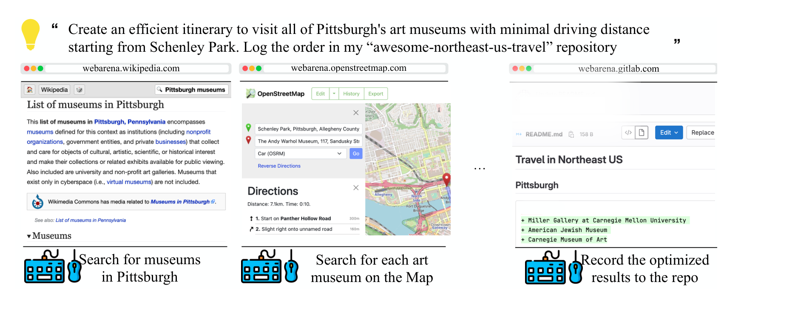
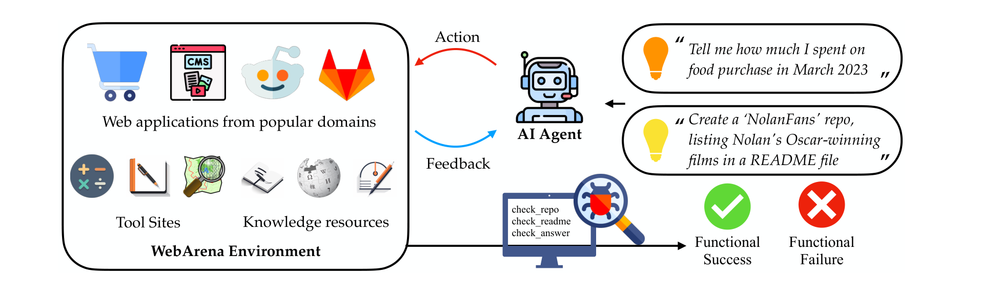
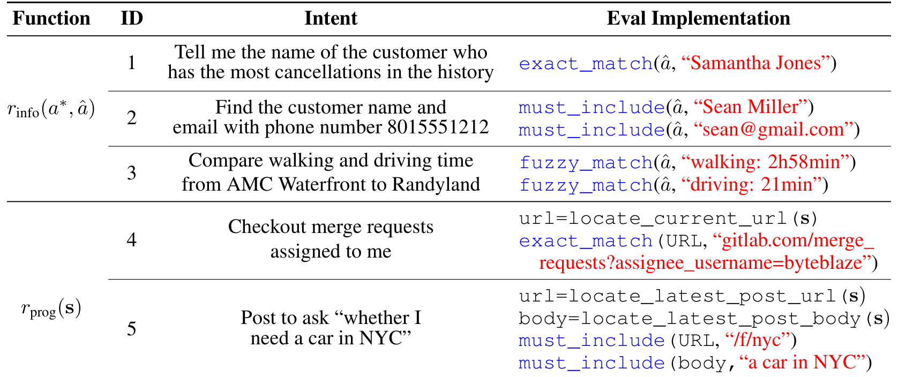
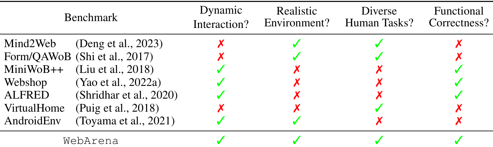

---
tags:
  - papers/大模型
  - papers/Agent与网页交互
aliases:
  - "WebArena"
date: 2024
arxiv: 2307.13854
---

# WebArena：面向自主智能体构建的真实网页环境

## 核心信息

- 标题: WebArena: A Realistic Web Environment for Building Autonomous Agents
- 标题翻译: WebArena：面向自主智能体构建的真实网页环境
- 作者: Shuyan Zhou、Frank F. Xu、Hao Zhu、Xuhui Zhou、Robert Lo、Abishek Sridhar、Xianyi Cheng、Tianyue Ou、Yonatan Bisk、Daniel Fried、Uri Alon、Graham Neubig
- 机构: Carnegie Mellon University
- 发表时间: 2024
- 发表渠道: ICLR 2024
- arXiv: 2307.13854
- 论文链接: https://arxiv.org/abs/2307.13854
- 代码 / 项目: https://webarena.dev/
- 数据 / 资源: 812 条任务实例与四个自托管站点（电商、论坛、GitLab、CMS）、三个工具站点（地图、计算器、便签）以及离线知识库，随项目以逐站点的容器镜像与确定性重置脚本发布
- 论文类型: 基准与环境构建（benchmark / environment）

## 原文摘要翻译

随着生成式人工智能的进展，现在已经有可能让自主智能体通过自然语言指令来管理日常任务。然而，当前的智能体主要是在简化的合成环境中被创建与测试，这导致它们与真实世界场景之间存在脱节。在本文中，我们为语言引导的智能体构建了一个高度真实且可复现的环境。具体来说，我们聚焦于在网页上执行任务的智能体，并构建了一个包含来自四个常见领域的完整可用网站的环境：电子商务、社交论坛讨论、协作式软件开发以及内容管理。我们的环境还配备了工具（例如地图）和外部知识库（例如用户手册），以鼓励类似人类的任务求解方式。在我们的环境之上，我们发布了一组基准任务，重点评估任务完成的功能正确性。我们基准中的任务多样、长程，并且旨在模拟人类在互联网上日常执行的任务。我们使用若干基线智能体进行实验，并整合了诸如先推理再行动之类的近期技术。结果表明，求解复杂任务具有挑战性：我们最好的基于 `GPT-4` 的智能体只取得了 14.41% 的端到端任务成功率，显著低于人类 78.24% 的表现。这些结果说明，仍需进一步发展鲁棒的智能体；当前最先进的大语言模型在这些真实生活任务上远未达到理想表现；同时 WebArena 可用于衡量这类进展。我们的代码、数据、环境复现资源以及视频演示均公开于 https://webarena.dev/。

## 创新点

1. **把“环境”本身当作可交付的科研产物**：四个真实站点的开源复刻（电商、论坛、GitLab、CMS）加三个工具站与离线知识库，全部打包成逐站点独立、不依赖外部挂载的容器镜像，并配套确定性重置脚本。这一点之所以重要，是因为允许智能体修改站点数据（建仓库、删评论、改商品）之后，没有低成本回滚就无法做可比的批量评测。
2. **结果导向而非路径匹配的评测协议**：信息检索任务用 $r_{\mathrm{info}}$ 比较答案（`exact_match` / `must_include` / `fuzzy_match`），导航与内容配置任务用 $r_{\mathrm{prog}}$ 在中间状态上做定位与断言。相比把预测动作序列和参考序列逐项比对的旧范式，这套协议承认同一目标存在多条合法路径。
3. **观测与动作接口的工程化**：观测是“URL + 打开的标签页 + 当前标签页内容”，内容可渲染为 HTML DOM、截图或无障碍树；动作是复合动作空间，元素既可用坐标也可用遍历生成的元素 ID 指代，于是“点哪个元素”变成了 n 路分类问题，消掉了坐标歧义，也让不同模态的智能体能在同一步数口径下比较。多标签页任务的引入在当时的同类环境里并不常见。
4. **把用户角色与权限差异纳入评测环境**：每个站点都带独立的用户档案（购物站两年内 35 单以上的顾客、维护多个热门仓库的 GitLab 用户、活跃的论坛用户、拥有全站读写权限的店主），这一设定让“越权不可行”这类任务成立，也让 N/A 类不可完成任务的标注有据可依。
5. **可复用的失败分析**：论文没有停在成功率上，而是把失败分解为提示开关引起的保守停止、观测偏见、细粒度观测与上一动作的遗漏，并给出可视化的失败轨迹。

## 一句话总结

WebArena 用四个自托管的真实站点复刻与 812 条模板化长程意图，把“网页智能体到底能不能把事做成”变成一个可复现、按功能正确性判分的基准，并测出最强 `GPT-4` 配置 14.41% 与人类 78.24% 之间的巨大鸿沟。

## 研究问题

论文要解决的不是某个智能体算法，而是**评测基础设施的缺口**：要判断一个网页智能体是否真的有用，必须同时具备真实性、可交互性与可复现性，而已有环境普遍只能占其二。

### 三个难以兼得的性质

论文把既有环境的问题拆成三类。第一类是**静态化**：一部分基准把网页状态在数据采集阶段就缓存下来，智能体只能访问这些预先固定的状态，探索空间与功能正确性检查都受限。第二类是**过度简化**：合成页面与模板化小任务让难度远低于真实网站，任务多样性随之下降。第三类是**不可复现**：依赖线上站点或真实应用的环境会受到验证码、内容更新与配置漂移的影响，跨时间的公平比较无法保证。

### 论文给出的取舍

WebArena 选择“用开源框架复刻站点 + 导入真实数据 + 全本地容器化”来同时换取真实性与可复现性。这个取舍本身也有代价：站点是真实站点的复刻而非真实站点，数据是采样导入的，站点选型与数据规模都会成为外部有效性的边界。这一点在后文的《局限》里会具体展开。

## 数据与任务定义

### 站点选型与数据来源

站点类别不是拍脑袋定的：作者先分析了大约 200 条来自作者本人浏览器历史的会话片段，把访问过的网站归纳成抽象类别，再挑出四个最常见的类别各实现一个实例，另外补上三个高频工具站与知识资源。

| 站点 | 实现基础 | 规模与数据 |
| --- | --- | --- |
| 电商 OneStopShop | Adobe Magento | 约 9 万件商品、300 多个品类，含价格、选项、描述、图片与评论，商品数据来自真实站点数据（含 WebShop 的数据转储） |
| 论坛 | Postmill（Reddit 的开源对应物） | 95 个 subreddit、127,390 篇帖子、661,781 个用户，从 top 50 subreddit 采样并手工补充美国东北部城市与机器学习相关版面 |
| GitLab | 官方 GitLab 项目 | 300 个仓库、1000 多个至少有一次提交的账号；按编程语言分层采样，八成来自 star 数前 10% 的仓库，两成来自后 10% |
| CMS | Magento 后台 + 官方示例数据 | 店铺内容与客户数据管理，配套一个全站读写权限的店主账号 |
| 地图 | OpenStreetMap | 受存储限制只覆盖美国东北部 |
| 知识库 | Kiwix 离线英文 Wikipedia、GitLab 与 Adobe Commerce 手册 | Wikipedia 知识截止 2023 年 5 月，手册从官方网站抓取 |

这张表的工程含义是：任务分布被站点数据规模直接决定——没有 9 万件商品就撑不起“找出评分最高的那把人体工学椅”，没有 300 个仓库就撑不起“按语言批量 fork”。

### 任务拆分：模板、实例与三类意图

标注者先花几分钟熟悉站点，再按三条准则写意图：意图要抽象到一两个动作做不完；要有创造性（例如“创建一个与我的 GitLab 账号相同的 Reddit 账号”）；要做成带可替换变量的模板，并为每个变量准备多个实例。最终得到 241 个模板、812 个实例化意图，平均每个模板 3.3 个实例。

意图分三类：信息检索（期望文本答案，且往往要跨多个页面、围绕用户自身数据，区别于只做一次检索的开放域问答）、站点导航（用搜索与链接找到特定信息或页面）、内容与配置操作（创建、修改、配置站点内容与账号设置）。跨站任务占 5.9%，其余分布在电商 23.0%、CMS 22.4%、GitLab 22.2%、地图 13.4%、论坛 13.1%。

*论文原图编号：Fig. 2。一条需要跨三个站点完成的意图：先在 Wikipedia 找博物馆，再在地图上规划路线，最后把结果写进 GitLab 仓库的 README。这里插入是因为它最能说明“高层意图 + 多步执行 + 跨站协作”的任务形态。*

### 评测标注协议与不可行任务

标注工作由作者完成：信息检索题的参考答案由作者与一位外部标注者各标一遍，分歧时由第三人定稿；其余任务的评测程序由三位熟悉 JavaScript 的作者编写；困难任务集体讨论。标注者必须自己完整执行一遍任务并检查中间状态，而不是只看最终页面。

论文还专门设计了**不可完成的任务**：受证据不足、用户权限或站点功能缺失限制，有些意图在 WebArena 里本就无法完成（例如“告诉我电商站点的联系电话”，而该站点上并不存在这类信息）。这类实例标注为 `N/A`，期望智能体给出等价回应，用来检测模型是否会编造无根据的结论。

### 人工基线的测法

人类基线从 170 个模板中各抽一条任务，交给五名计算机专业研究生完成。整体成功率 78.24%，其中信息检索类 74.68%，其余类 81.32%，平均耗时 110 秒。作者对失败轨迹做了归类：一半的失败源于误解意图（要时长却给了距离）、答案不完整（只要了姓名却漏了邮箱）、执行不完整（商品信息填了一半），其余则是执行完全跑偏。作者也说明了任务的领域知识门槛：像 GitLab 的 merge request 或 CMS 建商品这类操作，普通用户未必会做，因此任务是按“结果容易想象”而非“人人会做”来设计的。

## 方法主线

### 站点构建流程

先按类别选定开源框架，再把真实站点的数据导入本地实例，最后为每个站点构建自带数据库与依赖的容器镜像，并提供把环境恢复到确定初始态的重置流程。图中的环境总览把这一套结构、工具与评估出口画在一张图里。

*论文原图编号：Fig. 1。WebArena 的整体结构：左侧是四类站点、工具站与知识资源组成的自托管环境，中间是接收意图、发出动作并接收反馈的智能体，右侧是功能性成功与失败的判定出口。这里插入是因为它同时交代了环境的组成与评测的落点。*

### 观测空间：多标签页与三种内容表示

观测由三部分组成：当前网页 URL、打开的标签页列表、当前聚焦标签页的页面内容。页面内容有三种表示模式：原始 HTML 组成的 DOM 树、像素级截图，以及无障碍树。无障碍树是 DOM 的子集，每个元素只保留角色、文本内容与属性（例如是否可获得焦点），在保留结构信息的同时比 DOM 紧凑得多，这也是后文基线的实际输入。三种模式都支持限制到视口范围内的内容，以便塞进上下文长度或分辨率有限的模型。

> [!figure] Fig. 3 同一页面的三种观测表示
> 建议位置：方法主线（观测空间）
> 放置原因：这张图并排展示同一商品页的截图、HTML DOM 与无障碍树三种表示，是理解“观测空间如何选项化”以及后续基线为什么选无障碍树的关键图。
> 当前状态：保留占位；提取到的候选图被质量门判为正文污染且局部裁切，无法稳定还原成可独立解释的整图。

### 动作空间：复合动作与元素 ID

动作空间模仿浏览器上的键鼠操作，分三组：

- 元素操作：`click`、`hover`、`type`、`press`、`scroll`。
- 标签页操作：`tab_focus`、`new_tab`、`tab_close`。
- URL 导航：`goto`、`go_back`、`go_forward`。

此外还有一个 `noop` 与用于结束的 `stop [answer]`。

元素既可以用屏幕坐标 $(x, y)$ 指定，也可以用遍历 DOM 或无障碍树时生成的唯一元素 ID 指定；用 ID 时，元素选择变成 n 路分类，不需要智能体或底层实现再做消歧，这让不同模态的实现可以在同一步数口径下比较。

> [!figure] Fig. 4 动作空间清单
> 建议位置：方法主线（动作空间）
> 放置原因：这张表逐条列出 13 个动作及其语义，是复现环境接口时最需要对照的清单，放在动作空间小节最便于查阅。
> 当前状态：保留占位；未在页面中匹配到高置信度的整表候选，候选资产缺失。

### 机制流程

1. **输入**：环境把自然语言意图 $i$、当前观测（URL、打开的标签页、聚焦页面的无障碍树）与上一动作一起送入智能体。
2. **操作**：智能体输出单个动作（例如 `click [1582]`），环境在对应站点上执行该动作、**更新**站点状态与页面内容，并把新的观测作为反馈回传。
3. **终止**：智能体发出 `stop [answer]`，或触发最大步数、重复动作、连续非法动作等提前终止规则，轨迹到此固定。
4. **输出与判定**：评测器从轨迹的最终答案与中间状态中**提取**关键内容，用 $r_{\mathrm{info}}$ 或 $r_{\mathrm{prog}}$ 判定该实例成功与否，并写入结果统计。

### 评测协议：结果导向的奖励函数

环境被形式化为状态空间、动作空间、观测空间与转移函数组成的四元组，其中转移函数由各站点的底层实现确定，并且是确定性的：

$$E = \langle S, A, O, T \rangle, \qquad T : S \times A \to S$$

评测的目标是判定在给定意图下，轨迹是否达成了预期结果，而不是轨迹长得像不像参考解。

信息检索类任务用标注答案与模型预测之间的匹配函数判定，具体有三种实现：`exact_match` 要求完全一致；`must_include` 要求答案包含关键内容；`fuzzy_match` 则调用 `gpt-4-0613` 判断语义等价。

`fuzzy_match` 用于答案形式多样的场景，例如把 `2h58min` 与 2 小时 58 分视为等价，或要求数值必须与正确对象绑定。

导航与内容配置类任务用 $r_{\mathrm{prog}}(s)$，即对执行轨迹中的中间状态做程序化检查。每条实例由两部分组成：先用 locator 取回与意图相关的关键内容（数据库查询、站点接口调用或页面上的脚本选择器），再对取回内容做关键字断言，断言函数复用信息检索里的两种匹配方式。

*论文原图编号：Table 1。上半部分展示 $r_{\mathrm{info}}$ 的三种实现，下半部分展示 $r_{\mathrm{prog}}$ 如何用 locator 加断言检查中间状态。这里插入是因为它把评测协议从抽象描述落成了可实现的代码级例子。*

### 环境交付与重置

站点被拆成互相独立的容器镜像，每个镜像自带网站代码、数据库与依赖，且不依赖外部卷挂载，因此镜像可以直接分发给他人复现。由于部分任务会改写站点数据（新建用户、删除帖子、创建商品），评测者需要把容器从原始镜像重启来回到初始状态，视站点不同耗时从数秒到一分钟；论文认为多数任务是只读的信息收集，加上智能体推理本身的时间开销，这一重置成本虽不可忽略但对总评测时间的影响有限。

### 基线智能体设置

基线用三个模型（`GPT-3.5-TURBO-16K-0613`、`GPT-4-0613`、`TEXT-BISON-001`）与两种提示策略：直接预测下一个动作，或先做链式推理再给动作，两者都在上下文中放两个示例。

示例之前有一段系统说明，交代浏览器环境概览、允许的动作与规则，并要求模型在认为任务不可能完成时把答案写成 `N/A`。

论文把这条要求称为不可行提示，后文用 `UA hint` 指代它。

观测使用带元素 ID 的无障碍树，温度为 1.0、top-p 为 0.9、最多允许 30 步；同一观测上重复同一动作超过三次、或连续三次生成非法动作即提前终止。`TEXT-BISON-001` 额外允许十次重试以生成合法动作。

## 关键结果

### 主结果：人类与模型之间的数倍差距

在同样的任务集合上，人类完成率 78.24%，而带 `UA hint` 的最佳配置（`GPT-4` + 链式推理）只有 11.70%；去掉该提示后升到 14.41%，仍只有人类表现的五分之一左右。

| 链式推理 | `UA hint` | 模型 | 总成功率 | 可行任务成功率 | 不可行任务成功率 |
| --- | --- | --- | --- | --- | --- |
| 是 | 是 | `TEXT-BISON-001` | 5.05 | 4.00 | 27.78 |
| 否 | 是 | `GPT-3.5` | 6.41 | 4.90 | 38.89 |
| 是 | 是 | `GPT-3.5` | 8.75 | 6.44 | 58.33 |
| 是 | 是 | `GPT-4` | 11.70 | 8.63 | 77.78 |
| 否 | 否 | `GPT-3.5` | 5.10 | 4.90 | 8.33 |
| 是 | 否 | `GPT-3.5` | 6.16 | 6.06 | 8.33 |
| 是 | 否 | `GPT-4` | 14.41 | 13.02 | 44.44 |
| — | — | 人类 | 78.24 | 77.30 | 100.00 |

读这张表要注意三件事：第一，链式推理确实有帮助，`GPT-4` 在带提示组里因此提升 2.34 个百分点，但幅度远小于模型代差与人类差距；第二，总成功率这一列在不同提示设置下不可直接横向对比，因为可行与不可行两类子集的表现方向相反；第三，`TEXT-BISON-001` 低于 `GPT-3.5`，说明该模型与 `GPT-3.5` 之间仍存在明显差距。

### 提示开关比模型选择更能改变行为

`UA hint` 的效果是论文最值得注意的发现之一。它让 `GPT-4` 能识别 77.78% 的不可行任务，但也让它把 54.9% 的**可行**任务误判成不可行而提前停止；去掉这句话后，不可行任务识别率降到 44.44%，可行任务成功率却把总成功率推到 14.41%。也就是说，一句提示约束制造的是保守停止与完成率之间的权衡，而不是单纯的能力提升。`GPT-3.5` 在去掉提示后几乎没有这种自发推理，它的失败更多表现为编造答案、重复无效动作或撞上步数上限。

### 同一模板内的一致性很差

在至少有一次成功执行的 61 个模板上统计每个模板的成功率分布，`GPT-4` 只在 4 个模板上做到 100% 成功，`GPT-3.5` 一个模板都没有做到。同一模板的不同实例共享高层语义但轨迹不同，难度可以相差很大——`Fork metaseq` 是相对直接的操作，而同一模板派生出的“fork Facebook 的所有仓库”需要大量重复动作，复杂度完全不同。这条结果说明后续方法（带记忆、可复用技能的程序化执行）有明确的提升空间。

### 与既有基准的定位

论文用四个判据把 WebArena 与七个既有环境并排比较：是否支持动态交互、环境是否真实、任务是否多样且来自人类、是否评测功能正确性。

`WebArena` 是表里唯一四项全勾的一行。其余基准各缺一两项：`Mind2Web` 与 `Form/QAWoB` 缺动态交互，`WebShop` 与 `MiniWoB++` 在真实性与任务多样性上受限。

`ALFRED` 与 `VirtualHome` 属于具身模拟环境；`AndroidEnv` 使用真实 Android 应用，因而无法保证复现。

*论文原图编号：Table 4。WebArena 与七个既有基准在动态交互、真实环境、任务多样性与功能正确性四个维度上的对照表。这里插入是因为它是论文主张“环境侧增量”的唯一直接证据。*

### 可复现性配置

由于主实验使用温度 1.0 以鼓励探索，作者额外提供了 `GPT-3.5-TURBO-16K-0613` 在温度 0.0 下的结果 6.28%，并把执行轨迹一并放在代码仓库里，方便他人复算。这个补充实验规模有限，只覆盖一个模型，但至少说明低随机性设置下的量级与主结论一致。

## 深度分析

### 为什么一句提示就能改变整体成功率

`UA hint` 触发的是“主动宣告失败”这条出口。模型一旦把“任务可能不可行”纳入判断，就会在证据不足时选择停止，而网页任务中的证据往往是逐步积累的：第一屏页面通常不足以确认目标可达，因此过早停止会系统性地砍掉本来能完成的任务。论文给出的 54.9% 误判率说明，这个开关并没有教会模型判断可行性，只是把它推向了更保守的先验。对评测设计的启示是：可行性与不可行性是两种能力，必须分列报告，否则同一个总成功率会掩盖完全相反的行为变化。

### 观测偏见：先看到的信息优先

在 CMS 场景中，“2022 年销量第一的商品是什么”这类问题需要先在后台生成历史销售报告，再去报告里取值；但 `GPT-4` 会直接采用首页展示的近期热销信息，跳过生成报告这一步。真实网站为了可访问性会在多个位置重复呈现相似主题的信息，这种冗余对人是便利，对模型却成了“取第一个看起来相关的证据就收工”的诱因。我认为这不是单纯的知识问题，而是缺少“证据充分性检查”这一显式步骤：模型没有为自己设定“当前证据是否足以支持下结论”的门槛。

### 微观观测与上一动作的遗漏

论文附录给出的两个失败案例很具体：一个是在 GitLab 搜索场景中，智能体本应进入 `Users` 分区来完成任务，却停在 `Projects`；另一个是无障碍树里已经出现表示搜索词已填入的 `StaticText` 条目，智能体仍反复执行同一个输入动作，直到 30 步上限。此外模型经常忽略与观测一同给出的上一动作信息。作者把这类现象归因到预训练与对话微调：模型被训练成对当前对话直接作答，因此对细微的状态变化不敏感，也缺少主动探索与失败恢复的倾向。这两点恰好是长程网页任务最需要的能力。

> [!figure] Fig. 11 两个 GPT-4 失败轨迹
> 建议位置：深度分析
> 放置原因：这张图把“重复输入同一查询”和“走错分区”两类失败与对应的无障碍树条目并排放在一起，是理解观测解读失败最直接的证据图。
> 当前状态：保留占位；唯一一次允许的边界重裁仍把图体底部裁切，底部无障碍树条目与提示文本缺失，按合同不再二次重裁。

### 评测器本身也是被测模型

`fuzzy_match` 使用 `gpt-4-0613` 判定语义等价，等于让同一代模型既当运动员又当裁判。论文对此做了两件事：其一，人工抽查 40 例，其中 39 例与该模型判断一致；其二，识别出 82 个需要它评分的信息检索样本里有 49 个（约 60%）其实只是日期或时长的格式差异，于是程序化生成不同格式的日期与时长并做定量评估，两版 `GPT-4` 在该判断上都是 100% 准确。这个做法是负责任的处理方式，但它仍然只覆盖了格式等价这一子问题：真正需要语义判断的样本，其评测可靠性没有被单独量化。

### 哪些地方容易被误读

第一，14.41% 不是“模型能力上限”，而是特定提示、特定观测（无障碍树）、特定步数上限与特定评测器下的结果；换观测模态或加记忆模块都会移动这个数字。第二，人类 78.24% 来自五名计算机专业研究生的抽样任务，既不是全体人群的表现，也不是任务全集上的表现。第三，不可行任务的成功率对提示极度敏感，跨论文引用这个数字时必须带上提示设置。第四，也是最重要的一点：功能性正确性把过程约束放得很松，一个靠碰运气随机点出正确结果的成功轨迹与一条干净的高效轨迹会得到同样的分数，因此这个指标衡量的是结果，不是智能体的稳健程度。

## 局限

- 成功率的方差与置信区间在文中缺失。主实验使用温度 1.0 采样，模型之间 1 到 2 个百分点的差距是否显著无从判断，只有 `GPT-3.5` 在温度 0.0 下的单点补充结果。
- 环境的“可复现”主要是工程论证而非实验结论：站点以容器镜像交付并支持重置，但论文没有给出跨机器、跨时间复现同一批结果的对照实验，重置耗时对整体评测时间的影响也只有定性判断。
- 评测器的可靠性只被部分验证。`fuzzy_match` 抽查 40 例，且评判模型与被测模型同源；`r_prog(s)` 的 locator 与关键字断言由人工编写，其假阴性率与“目标已达成但断言判失败”的实例占比都属于空白。
- 人工基线仅五名计算机专业研究生、每个模板抽一条任务，样本量小且专业背景集中；作者自己也承认任务的领域知识门槛会让不同人群的表现分化。
- 站点与数据带有明确的时空边界：地图只覆盖美国东北部，Wikipedia 知识截止 2023 年 5 月，商品与帖子来自采样数据，站点选型由约 200 条作者浏览记录归纳而来。任务的多样性来自作者群体自身的使用习惯，这一取样方式本身就会带入偏差。
- 基线只覆盖三个语言模型与两种提示策略，没有测试截图输入、记忆与反思模块、程序化技能复用或微调模型，因此论文关于“当前 LLM 缺少探索与失败恢复能力”的假设仍然是解释性的，而不是通过控制实验证明的因果结论。

## 我的笔记

- 这篇论文最值得借用的不是某个模型技巧，而是**评测基础设施的交付形态**：环境、数据、重置脚本与评测程序一起打包，并逐站点隔离成镜像。任何需要智能体改写外部状态的评测，都应该先想清楚怎么把状态退回去。
- 把“结果正确性”和“过程约束”分开处理是一次务实的协议设计。用 locator 取关键状态、再用匹配函数断言，好处是不写死路径；但代价是评测器质量直接决定基准质量，因此写这类基准时必须同时报告断言器的验证方式，就像论文对 `fuzzy_match` 做的那样。
- `UA hint` 那一组数字是我认为全文最有迁移价值的实验设计：把提示里的一句约束当作实验变量单独消融，并分列可行与不可行子集。我以后做智能体评测时会默认这样做，因为总成功率很容易掩盖能力方向相反的变化。
- 失败模式里最“可修”的是重复动作与忽略上一动作，这更像接口或状态表达问题而非模型能力上限：如果把“当前搜索框已是 DMV area”这类状态直接放进一个更醒目的结构化字段，或干脆在环境侧对无效重复动作给出显式惩罚与反馈，这类失败应当明显减少。
- 对复现者来说，需要预留的成本是容器镜像与重置开销。逐站点独立镜像加上数据库内置，镜像体积不会小；如果要跑多轮自动评测，重置流水线应当并入评测框架，而不是手工重启。

## 引用

- Zhou et al. (2024). WebArena: A Realistic Web Environment for Building Autonomous Agents. ICLR 2024. arXiv:2307.13854
- Deng et al. (2023). Mind2Web: Towards a Generalist Agent for the Web. arXiv:2306.06070
- Shi et al. (2017). World of Bits: An Open-Domain Platform for Web-Based Agents. ICML 2017.
- Liu et al. (2018). Reinforcement Learning on Web Interfaces Using Workflow-Guided Exploration. ICLR 2018.
- Yao et al. (2022). WebShop: Towards Scalable Real-World Web Interaction with Grounded Language Agents. NeurIPS 2022. arXiv:2207.01206
- Shridhar et al. (2020). ALFRED: A Benchmark for Interpreting Grounded Instructions for Everyday Tasks. CVPR 2020.
- Puig et al. (2018). VirtualHome: Simulating Household Activities via Programs. CVPR 2018.
- Toyama et al. (2021). AndroidEnv: A Reinforcement Learning Platform for Android. arXiv:2105.13231
- Wei et al. (2022). Chain-of-Thought Prompting Elicits Reasoning in Large Language Models. NeurIPS 2022. arXiv:2201.11903
- Yao et al. (2022). ReAct: Synergizing Reasoning and Acting in Language Models. arXiv:2210.03629
- Nakano et al. (2021). WebGPT: Browser-Assisted Question-Answering with Human Feedback. arXiv:2112.09332
- Rajpurkar et al. (2016). SQuAD: 100,000+ Questions for Machine Comprehension of Text. EMNLP 2016.
- Brockman et al. (2016). OpenAI Gym. arXiv:1606.01540
